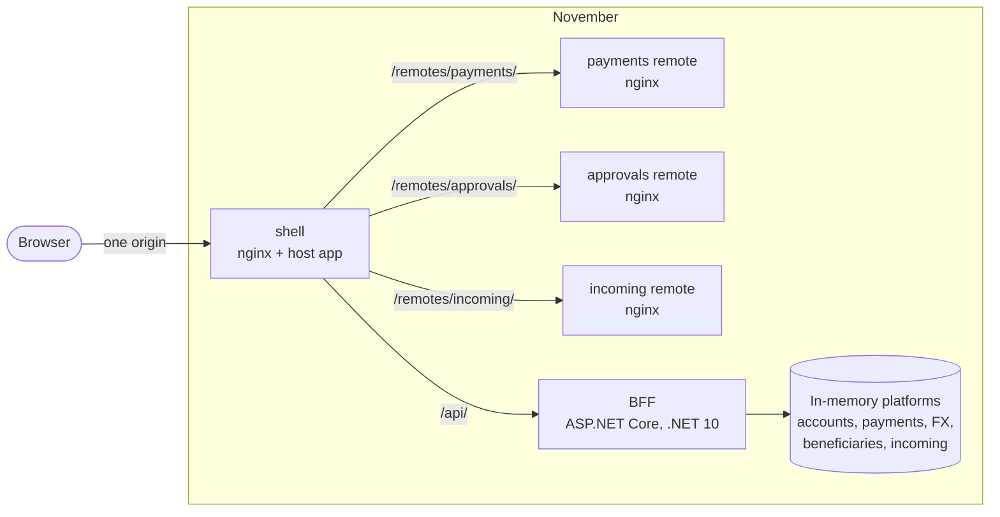

# November

November is a reference repository for learning how to build a modern web application as **React micro frontends** behind a **.NET Backend-for-Frontend**, packaged as containers and described for **Azure Container Apps** with Bicep.

The business domain is a **fictional** business-banking portal: cross-border payments, 60-second FX quotes and maker-checker approvals. The bank, the company, the people, the rates and every piece of data are invented. Nothing here refers to a real institution, and nothing here is financial software you should deploy.

Everything runs on your machine with Docker and nothing else. There is no database, no identity provider and no cloud account to set up.

## What it teaches

- **Micro frontends with Module Federation 2.0.** A shell loads three separately built and deployed remotes at runtime, shares four libraries as singletons, and keeps working when a remote is down.
- **The Backend-for-Frontend pattern.** One service shapes data for the UI, owns the session cookie and speaks one error format. A single dashboard call aggregates three platforms.
- **Vertical slices and the mediator pattern in .NET 10.** Minimal APIs, one file per use case, pipeline behaviors for logging and validation.
- **Real-world business rules.** Four-eyes approval, time-limited and single-use FX quotes, and why the approver must commit to a fresh quote.
- **One origin, no CORS.** The shell's nginx is the only door in. It serves the app and proxies the API and the remotes.
- **Containers and Azure.** Non-root multi-stage images, Container Apps with internal ingress, managed identity, Key Vault, and Bicep modules.
- **CI/CD.** Azure Pipelines definitions for build, image push and staged deployment.

## Architecture



The browser only ever talks to the shell. The shell serves the host app, loads each remote's manifest through `/remotes/<name>/`, and forwards `/api/` to the BFF. The BFF calls fake downstream platforms through interfaces, which is where real HTTP clients would plug in. [`docs/architecture.md`](docs/architecture.md) goes much deeper.

## Tech stack

| Layer | Technology |
| --- | --- |
| Front end | React 19, TypeScript (strict), CSS Modules, React Router 8, TanStack Query 5, react-hook-form with zod |
| Bundling and federation | Rsbuild 2, Module Federation 2.0 |
| Web server | nginx (unprivileged), used for the shell and every remote |
| Backend | .NET 10, ASP.NET Core minimal APIs, martinothamar/Mediator, FluentValidation, cookie authentication |
| Contracts | OpenAPI document and Scalar reference from the BFF, plus [`docs/api-contract.md`](docs/api-contract.md) |
| Tests | xUnit v3 on Microsoft.Testing.Platform (three end-to-end HTTP tests), Vitest unit tests for the FX countdown |
| Containers | Docker, multi-stage builds, chiseled .NET runtime image, Docker Compose |
| Cloud | Azure Container Apps, Container Registry, Key Vault, managed identity, Log Analytics, Application Insights |
| Infrastructure as code | Bicep |
| CI/CD | Azure Pipelines (primary), GitHub Actions (build-only mirror) |

## Quickstart

### Everything in containers

You need Docker with Compose v2.

```bash
docker compose up --build
```

Open **http://localhost:3000** and sign in as one of the personas below. The BFF is also published on http://localhost:5080 so you can try the API directly (`/scalar` has an interactive reference).

Stop it with `docker compose down`. All data lives in memory, so it resets every time the BFF restarts.

### Local development

You need the .NET 10 SDK and Node 24 (see `frontend/.nvmrc`).

```bash
dotnet run --project bff/src/November.Bff.Api
```

In a second terminal:

```bash
cd frontend
npm ci
npm run dev
```

Open **http://localhost:3000**. The shell's dev server proxies `/api` to the BFF on port 5080 and `/remotes/<name>` to the remotes on ports 3001 to 3003, the same way nginx does in containers.

### Checks

```bash
cd bff && dotnet build November.Bff.slnx && dotnet test --solution November.Bff.slnx
cd ../frontend && npm run typecheck && npm run build && npm run test
```

## The three personas

Harbourline Trading Ltd, a fictional company, has three portal users. There are no passwords. You pick a persona on the sign-in screen.

| Persona | Roles | What they can do |
| --- | --- | --- |
| Alex Morgan (`alex`) | Capturer | Enter payments. Cannot approve anything. |
| Sam Okafor (`sam`) | Approver | Approve or reject what others entered. |
| Jordan Reeves (`jordan`) | Capturer and Approver | Both, but the four-eyes rule stops them approving their own payments. |

## Try this

A guided walk through the whole system. It takes about five minutes.

1. **Sign in as Alex** and look at the dashboard. One request fed the account balances, the approval counts and the recent payments.
2. **Pay a EUR beneficiary from a GBP account.** Open **Payments**, choose **Pay a saved beneficiary**, pick *Brandt Maschinenbau GmbH*, pay from *GBP Operating*, and enter 1,000 as the amount in GBP. Choose a purpose code, enter a reference, tick the declarations and go to the review step.
3. **Accept the quote.** The review step shows an FX rate and a 60-second countdown. Let it run out once and see the quote expire, ask for a new one, then accept it and submit. The payment is now **Pending approval**.
4. **Try to approve it as Alex.** Open **Approvals** to see that Alex has no approval rights.
5. **Switch to Jordan.** Sign out and sign in as Jordan. In **Approvals**, open the payment Jordan captured (the seeded EUR payment). Approve is blocked: the person who captured a payment cannot approve it. Jordan can still approve Alex's payments, but leave this one for Sam.
6. **Approve as Sam.** Sign in as Sam, open Alex's new payment in **Approvals**, and approve it. Because it involves FX, Sam must accept a **fresh quote**. The rate Sam accepts is the one that applies.
7. **Watch it complete.** The payment moves to **Processing**, then to **Completed** after about eight seconds. The detail page refreshes itself while it is processing, and the timeline shows who did what.
8. **Respond to an incoming payment.** In **Incoming**, open the USD payment from *Redwood Outfitters LLC*. It needs a purpose code and acceptance of an FX quote. Submit both. It moves to **Processing** and then **Credited**.

Want to see the contract instead of the UI? The same steps with `curl` are in [`docs/bff/README.md`](docs/bff/README.md#run-locally).

## Repository map

```text
bff/            .NET 10 Backend-for-Frontend (src/November.Bff.Api, tests/November.Bff.Tests)
frontend/       npm workspaces: apps/shell, apps/payments, apps/approvals, apps/incoming,
                packages/ui (design system), packages/shared (contract types, API client)
infra/          Azure Bicep: main.bicep, modules/, dev and prod parameter files
pipelines/      Azure Pipelines definitions, templates and variables
.github/        GitHub Actions workflow (build-only mirror) and Dependabot
.azuredevops/   Pull request template for Azure DevOps
docs/           Guides, the API contract and the architecture decision records
docker-compose.yml   The whole system on one machine
AGENTS.md       Working rules for contributors
```

## Learning path

Read in this order, or jump to what you need. The full index is [`docs/README.md`](docs/README.md).

1. [`docs/domain.md`](docs/domain.md). The banking concepts the app is built around.
2. [`docs/architecture.md`](docs/architecture.md). The system, a request end to end, the security model and the seams to real systems.
3. [`docs/api-contract.md`](docs/api-contract.md). Every endpoint, type and error code.
4. [`docs/bff/README.md`](docs/bff/README.md). Inside the BFF.
5. [`docs/frontend/README.md`](docs/frontend/README.md). Inside the micro frontends.
6. [`docs/infra/README.md`](docs/infra/README.md). The Azure infrastructure.
7. [`docs/infra/docker.md`](docs/infra/docker.md). Images and Compose.
8. [`docs/infra/ci-cd.md`](docs/infra/ci-cd.md). Pipelines.
9. [`docs/adr/README.md`](docs/adr/README.md). The ten decisions and their trade-offs.
10. [`docs/how-it-was-built.md`](docs/how-it-was-built.md). The build order and the problems met along the way.

## CI/CD

The primary CI/CD reference is **Azure Pipelines**, in [`pipelines/`](pipelines), because Azure DevOps is the platform this design targets. `ci.yml` validates every change and `deploy.yml` builds and pushes images and deploys to dev and then prod, with approvals on prod. These definitions are references: they are valid YAML, but this repository never runs them.

[`.github/workflows/ci.yml`](.github/workflows/ci.yml) exists only so the public GitHub copy shows a green build. It builds and tests the BFF, typechecks and builds the front end, compiles the Bicep and builds the five images. It never deploys. See [`docs/infra/ci-cd.md`](docs/infra/ci-cd.md).

## License

MIT. See [`LICENSE`](LICENSE).
