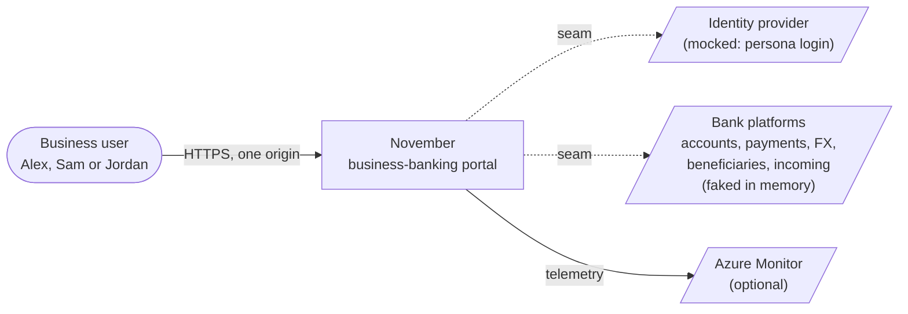
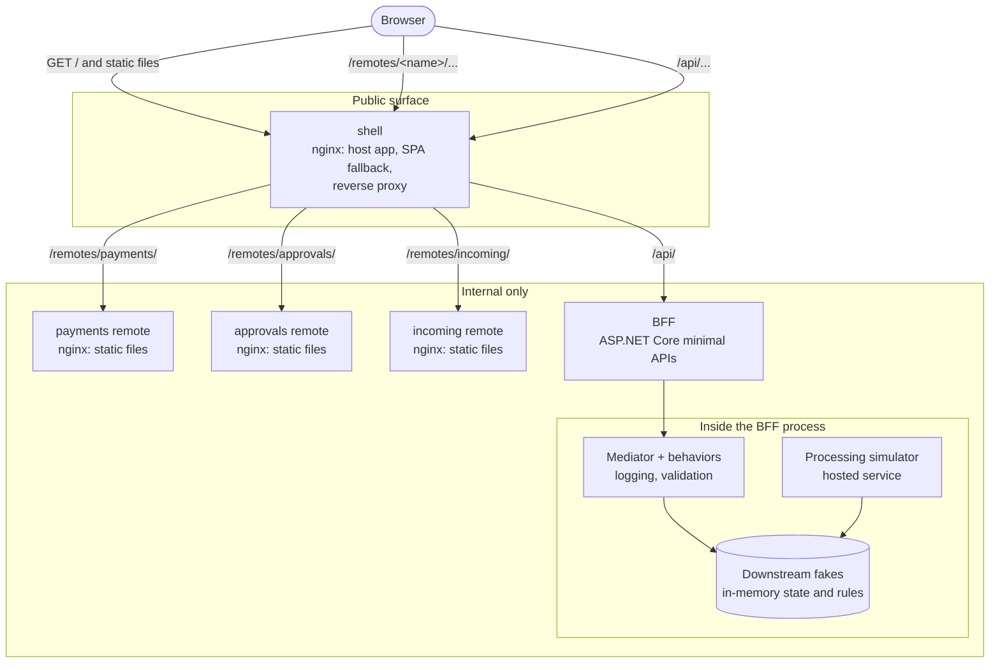
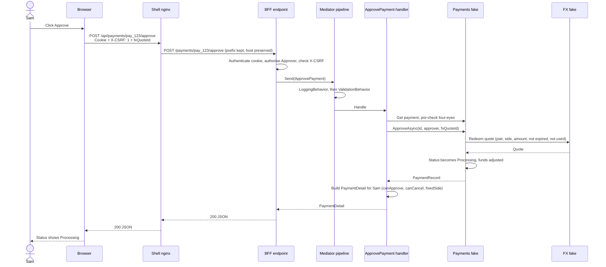
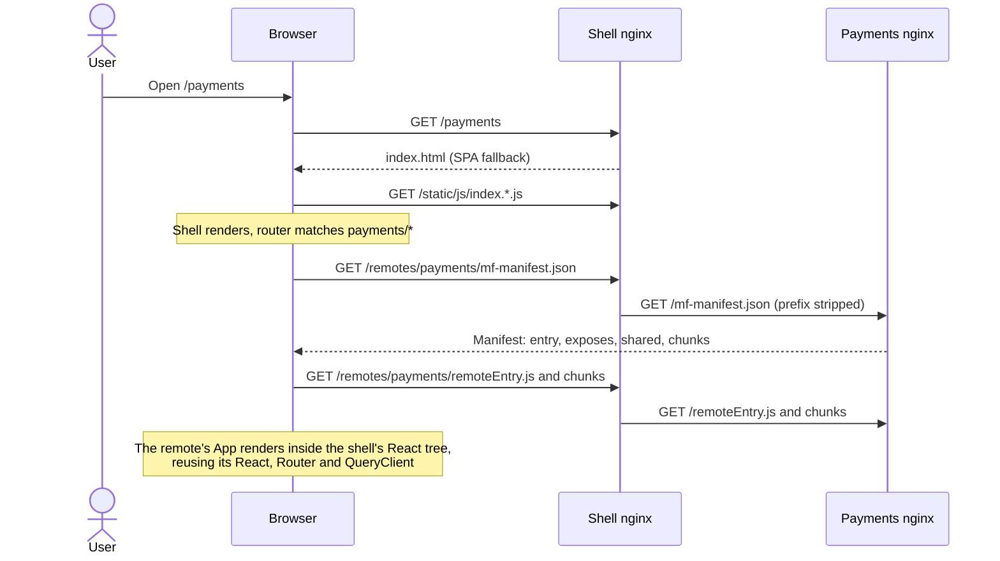
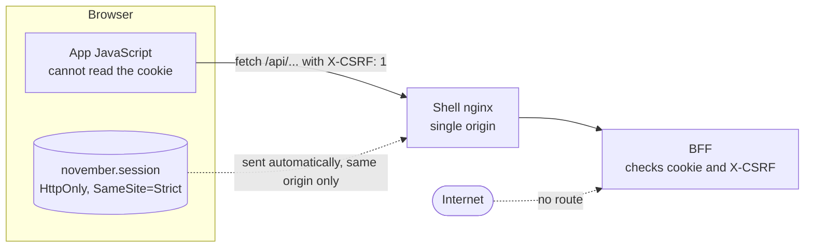

# Architecture

This page shows how November fits together: who talks to whom, what happens during one request, how a micro frontend gets loaded, how the system is secured, and which parts are stand-ins for real systems. The detailed guides are linked at the end of each section.

Read [`domain.md`](domain.md) first if the business terms (maker-checker, FX quote, beneficiary) are unfamiliar.

## System context

November is a web portal. It has two outside dependencies that a real bank would provide: an identity provider and the platforms that hold accounts and payments. Both are replaced here by in-process stand-ins, behind interfaces, so the whole system runs on a laptop. Those seams are described under [Where the real-world seams are](#where-the-real-world-seams-are).

## Containers

| Container | Technology | Role |
| --- | --- | --- |
| `shell` | nginx (unprivileged) serving a React host app | The only public entry point. Serves the host, proxies `/api/` and `/remotes/<name>/`. |
| `payments`, `approvals`, `incoming` | nginx serving a Module Federation remote | Static files: a manifest, an entry script and chunks. |
| `bff` | ASP.NET Core on .NET 10, chiseled image | UI-shaped API, session cookie, validation, orchestration. Holds all in-memory state. |

In Docker Compose and in Azure the topology is the same. The only thing that changes is how the shell finds its upstreams: four environment variables (`BFF_UPSTREAM`, `PAYMENTS_UPSTREAM`, `APPROVALS_UPSTREAM`, `INCOMING_UPSTREAM`). See [`infra/docker.md`](infra/docker.md) and [`infra/README.md`](infra/README.md).

## One request, end to end

This is Sam approving a payment that involves currency conversion. It shows every hop, and where the rules live.

What to notice:

- **The endpoint contains no logic.** It builds a request record and sends it through the mediator. See [ADR 0003](adr/0003-mediator-pattern.md) and [ADR 0004](adr/0004-vertical-slice-architecture.md).
- **Validation is a pipeline behavior**, so it runs before every handler without any handler asking for it. A failure becomes a `400` `ProblemDetails` with a `code`.
- **The business rules live in the downstream fake**, not in the BFF. The handler pre-checks four-eyes only to give a clear error before a quote is spent. See [ADR 0005](adr/0005-maker-checker-and-fx-requote.md).
- **The response is UI-shaped.** `canApprove` is computed for the signed-in viewer, so the UI never re-implements the rules.
- **Failures keep their shape.** Whatever goes wrong, the browser gets a `ProblemDetails` body with a machine-readable `code`. See [`api-contract.md`](api-contract.md#errors).

The BFF's request lifecycle, step by step, is in [`bff/README.md`](bff/README.md#3-request-lifecycle).

## How a remote is loaded

Points that make this work:

1. **The shell does not know the remotes at build time.** It registers them at runtime from `/remotes/<name>/mf-manifest.json` and loads `<name>/App` with `React.lazy`. A remote can be redeployed without rebuilding the shell.
2. **Assets resolve relative to the manifest.** Each remote is built with `publicPath: "auto"`, so chunk URLs come out under `/remotes/payments/...`. That is why the shell's nginx can strip the prefix and the same bundle works behind any path.
3. **Four libraries are shared singletons**: `react`, `react-dom`, `react-router` and `@tanstack/react-query`. There is one React, one router and one query cache in the page.
4. **A broken remote does not break the portal.** The shell wraps each remote in `Suspense` and an error boundary and shows a friendly message with a retry.
5. **Remotes never import each other.** They share props from the shell, a few `CustomEvent`s on `window`, URLs and the BFF.

The full explanation, including the async bootstrap and the shared-singleton rules, is in [`frontend/README.md`](frontend/README.md#how-module-federation-works-here) and [ADR 0001](adr/0001-micro-frontends-with-module-federation.md).

## Security model

| Control | What it does |
| --- | --- |
| **Same origin** | The browser only calls the shell's origin, for the app, the remotes and the API. There is no CORS configuration anywhere, and no cross-origin requests to approve. |
| **HttpOnly session cookie** | The BFF issues the cookie. JavaScript cannot read it, so an XSS bug cannot steal the session, and the browser never holds a token. |
| **SameSite=Strict** | The cookie is only sent on same-site requests. |
| **CSRF header** | Every non-GET request must carry `X-CSRF: 1`. A cross-site form post cannot add a custom header, and a cross-origin `fetch` that adds one needs a CORS preflight the API never approves. The header carries no secret. |
| **Roles and policies** | `Capturer` and `Approver` come from the session. Handlers read them through `ICurrentUser`, never from `HttpContext`. |
| **Four-eyes** | The platform refuses a capturer approving or rejecting their own payment. The BFF pre-checks and also returns `canApprove` so the UI hides the action. |
| **Internal-only ingress** | In Azure only the shell has external ingress. The BFF and the remotes cannot be reached from the internet, so their own checks are never the only line of defence. |
| **Security headers** | nginx sets `X-Content-Type-Options`, `Referrer-Policy` and `frame-ancestors 'none'`, and hides upstream copies so the browser sees one policy. |
| **No secrets, no root** | Images run as non-root. Azure access uses a user-assigned managed identity, and secrets live in Key Vault. |

Mock authentication is on in every environment of this demo, so anyone who can reach the site can sign in as any persona. That is deliberate and documented in [ADR 0006](adr/0006-in-memory-downstream-and-mock-auth.md). The cookie and CSRF details are in [`bff/README.md`](bff/README.md#6-authentication-the-cookie-csrf-and-the-persona-seam), and the shell proxy is in [ADR 0007](adr/0007-shell-as-single-entry-point.md).

## Where the real-world seams are

November fakes three things. Each fake sits behind an interface or a mode switch, so replacing it does not touch the handlers or the UI.

| Seam | Today | In production | Where to change it |
| --- | --- | --- | --- |
| **Identity provider** | `Auth:Mode=Mock`. `GET /api/session/personas` and `POST /api/session/login` issue a cookie for a chosen persona. | OpenID Connect against a real provider. The cookie stays the session; roles come from app roles in the token. | `AuthExtensions.AddBffAuthentication` and `SessionEndpoints`. Sketch in [`bff/README.md`](bff/README.md#swapping-mock-auth-for-entra-id). |
| **Downstream platforms** | Singleton in-memory fakes implementing `IAccountsService`, `IPaymentsService`, `IFxService` and friends, with seeded data and the business rules. | One typed `HttpClient` per platform with timeouts, retries and credentials. The platforms own the rules. | `AddInMemoryDownstream`. Sketch in [`bff/README.md`](bff/README.md#10-swapping-the-fakes-for-real-http-clients). |
| **Persistence** | State lives in process memory and resets on restart. A hosted service moves payments from `Processing` to `Completed` after a delay. | Databases owned by the platforms, not by the BFF. Asynchronous completion arrives as events or polling, not a timer. | Inside the downstream platforms. The BFF itself stays stateless. |

## What changes for production

The structure is meant to carry over. These are the changes it does not make for you.

- **Real identity.** Replace persona login with OpenID Connect. Remove the mock endpoints. Take the client secret or certificate from Key Vault.
- **Real downstream services.** Write the HTTP clients. Add resilience and idempotency keys for non-idempotent calls such as create and approve. Translate downstream errors into `DomainException`.
- **Run more than one BFF replica.** The BFF must be stateless first. State moves to the platforms, and the cookie's Data Protection key ring moves to shared storage, or a restart or scale-out signs everyone out.
- **Trust forwarded headers properly.** The BFF currently trusts `X-Forwarded-*` from anywhere because it has no public ingress. If it can ever be reached directly, restore the proxy allow-list.
- **Harden the edge.** Put a web application firewall and a custom domain in front of the shell, add a strict Content Security Policy, and consider a private network and private endpoints. The checklist is in [`infra/README.md`](infra/README.md#production-hardening-checklist).
- **Payment limits, fees, cut-off times, audit retention and beneficiary approval.** Real banking rules, intentionally left out. See the assumptions in [`domain.md`](domain.md#assumptions-made-for-this-demo).
- **Operations.** Alerts, dashboards, SLOs, backup and disaster recovery, and deployment of the pipelines in [`pipelines/`](../pipelines), which are references only.

## Related reading

- [`bff/README.md`](bff/README.md), [`frontend/README.md`](frontend/README.md) and [`infra/README.md`](infra/README.md) for each part in depth.
- [`adr/README.md`](adr/README.md) for the decisions and their trade-offs.
- [`how-it-was-built.md`](how-it-was-built.md) for the order things were built in and the problems met.
