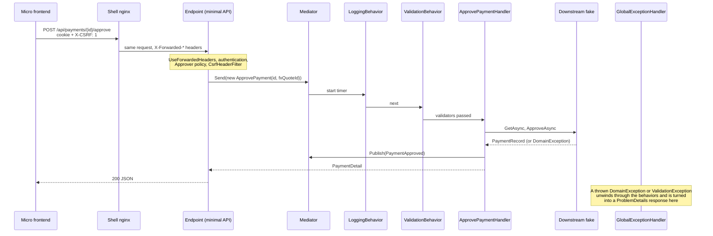
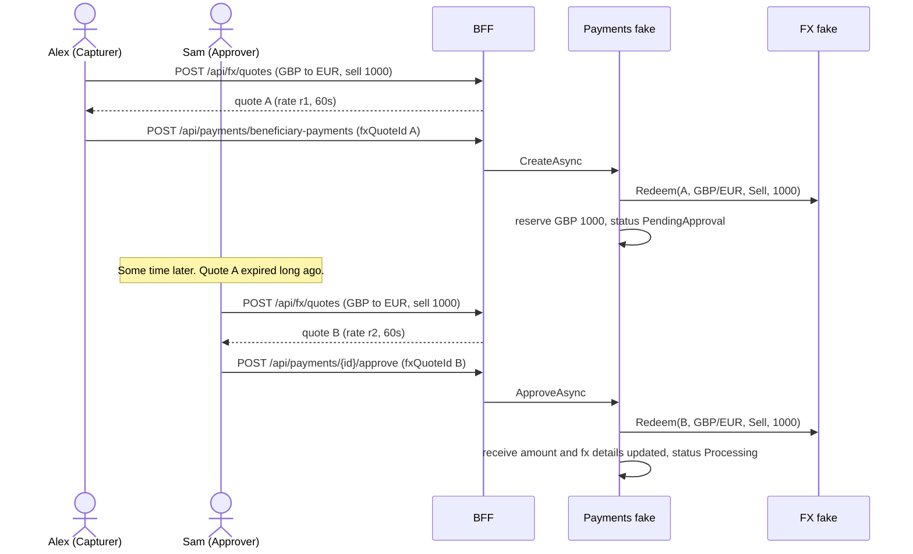

# The BFF

The Backend-for-Frontend (BFF) is the single .NET service that the November micro frontends talk to. It lives in [`bff/`](../../bff). This page explains what it is, how it is built, why it is built that way, and how to change it.

The API it exposes is described in [`docs/api-contract.md`](../api-contract.md). The domain it models is described in [`docs/domain.md`](../domain.md). The decisions behind it are in the ADRs:

- [ADR 0002: Backend for Frontend](../adr/0002-backend-for-frontend.md)
- [ADR 0003: Mediator pattern](../adr/0003-mediator-pattern.md)
- [ADR 0004: Vertical slice architecture](../adr/0004-vertical-slice-architecture.md)
- [ADR 0005: Maker-checker and FX re-quote](../adr/0005-maker-checker-and-fx-requote.md)
- [ADR 0006: In-memory downstream and mock auth](../adr/0006-in-memory-downstream-and-mock-auth.md)

## Contents

1. [What a BFF is, and why we have one](#1-what-a-bff-is-and-why-we-have-one)
2. [Project layout](#2-project-layout)
3. [Request lifecycle](#3-request-lifecycle)
4. [The mediator pattern](#4-the-mediator-pattern)
5. [Adding a feature, step by step](#5-adding-a-feature-step-by-step)
6. [Authentication, the cookie, CSRF and the persona seam](#6-authentication-the-cookie-csrf-and-the-persona-seam)
7. [Error handling](#7-error-handling)
8. [FX quotes and four-eyes](#8-fx-quotes-and-four-eyes)
9. [The processing simulator](#9-the-processing-simulator)
10. [Swapping the fakes for real HTTP clients](#10-swapping-the-fakes-for-real-http-clients)
11. [Running, testing and Docker](#11-running-testing-and-docker)
12. [Deployment notes and trade-offs](#12-deployment-notes-and-trade-offs)

## 1. What a BFF is, and why we have one

A bank has many backend platforms: accounts, payments, FX dealing, beneficiaries, reference data. Each one has an API designed around its own domain. A screen in the browser rarely matches any single one of them. The dashboard needs accounts, pending payments and incoming payments at once. A payment's detail page needs the payment, the source account, the beneficiary and the purpose code description.

Two ways to deal with that:

- Let every micro frontend call every platform and stitch the results together in the browser. That is chatty, leaks the platform topology to the client, makes every team re-implement the same joins, and forces tokens and cross-origin calls into the browser.
- Put one server-side layer between the browser and the platforms that is shaped around **what the UI needs**. That layer is the Backend-for-Frontend.

In November the BFF:

- **Aggregates**: `GET /api/dashboard` makes three downstream calls in parallel and returns one UI-shaped response ([`GetDashboard.cs`](../../bff/src/November.Bff.Api/Features/Dashboard/GetDashboard.cs)).
- **Shapes**: a payment is stored by the platform as ids and amounts. The BFF returns names, the beneficiary, the purpose description and the booleans `canApprove` and `canCancel` ([`PaymentViewBuilder.cs`](../../bff/src/November.Bff.Api/Features/Payments/PaymentViewBuilder.cs)).
- **Owns the session**: the browser holds an HttpOnly cookie, never a token. The BFF would hold any downstream credentials.
- **Enforces authorization at the edge**: roles (Capturer, Approver) are checked before a use case runs, and the four-eyes rule is pre-checked to give friendly errors.
- **Stays thin**: it does not own business rules. Status transitions, four-eyes, FX quote validity and balances belong to the downstream platforms. In this repo those platforms are in-memory fakes behind interfaces, so the line is visible in the code.

A useful test for whether code belongs in the BFF: *would a second, different client (say, a mobile app) want a different version of this?* If yes, it is UI orchestration and belongs here. If every client needs it identical, it belongs in a downstream platform.

## 2. Project layout

```text
bff/
  global.json                      SDK 10.0.x, opts in to the Microsoft.Testing.Platform runner
  Directory.Build.props            nullable, implicit usings, warnings as errors, latest analysis level
  Directory.Packages.props         central package versions
  November.Bff.slnx
  Dockerfile  .dockerignore  README.md
  src/November.Bff.Api/
    Program.cs                     composition root: services, pipeline, route groups
    appsettings.json               Auth:Mode, Simulation:ProcessingDelaySeconds
    Features/                      vertical slices, one folder per area
      Payments/
        ApprovePayment.cs          request + validator + handler for one use case
        CreateBeneficiaryPayment.cs
        ...
        PaymentResponses.cs        UI-shaped response records shared by the area
        PaymentViewBuilder.cs      builds responses from downstream records
        PaymentPolicy.cs           canApprove / canCancel
        PaymentApproved.cs         notification + audit-log handler
        PaymentsEndpoints.cs       minimal API routes for the area
      Incoming/  Dashboard/  Session/  Accounts/  Beneficiaries/  Fx/  Reference/
    Downstream/
      IDownstreamServices.cs       the interfaces a real BFF would call over HTTP
      Models/                      what the platforms return
      Fakes/                       thread-safe in-memory implementations with seed data
      DownstreamServiceCollectionExtensions.cs   the single place the fakes are registered
    Infrastructure/
      Auth/                        cookie auth, policies, ICurrentUser, mock personas
      Behaviors/                   LoggingBehavior, ValidationBehavior
      ErrorHandling/               DomainException, Errors, Problems, GlobalExceptionHandler
      Http/                        CSRF filter, UTC date converter
      Validation/                  IBAN, SWIFT, routing number, money rules
      Health/                      readiness check
  tests/November.Bff.Tests/        three tests: four-eyes, expired quote, end-to-end approval
```

Rule of thumb for where code goes:

| You are writing... | Put it in |
| --- | --- |
| A new use case (request, validation, handler) | `Features/<Area>/<UseCase>.cs` |
| The HTTP route for it | `Features/<Area>/<Area>Endpoints.cs` |
| A call to a bank platform | an interface in `Downstream/IDownstreamServices.cs`, a fake in `Downstream/Fakes/` |
| A business rule (status, balance, quote) | the fake. That is the platform's job |
| Something every request needs (logging, validation, auth, errors) | `Infrastructure/` |

## 3. Request lifecycle



The order is fixed in `Program.cs`: the first behavior in the list is the outermost.

```csharp
builder.Services.AddMediator(options =>
{
    options.ServiceLifetime = ServiceLifetime.Scoped;
    options.PipelineBehaviors = [typeof(LoggingBehavior<,>), typeof(ValidationBehavior<,>)];
});
```

Logging is outermost so it also times and reports validation failures. Mediator is registered as `Scoped` because handlers depend on `ICurrentUser`, which is read from the current `HttpContext`.

An endpoint does three things only: bind the HTTP request, build the request record, send it.

```csharp
group.MapPost("/{id}/approve", async (string id, ApprovePaymentRequest? body, ISender sender, CancellationToken cancellationToken) =>
        TypedResults.Ok(await sender.Send(new ApprovePayment(id, body?.FxQuoteId), cancellationToken)))
    .RequireAuthorization(Policies.Approver);
```

(from [`PaymentsEndpoints.cs`](../../bff/src/November.Bff.Api/Features/Payments/PaymentsEndpoints.cs)). Everything interesting happens after `sender.Send`.

## 4. The mediator pattern

### What it is

The mediator pattern replaces direct calls between an endpoint and the code that does the work with a message: the endpoint builds a request record and hands it to a mediator, which finds the one handler for that type and runs it. Because every request flows through one place, cross-cutting behavior (logging, validation, transactions, caching) can be added once as a **pipeline behavior** instead of being repeated in every endpoint.

A use case in this repo is one file with four parts. From [`ApprovePayment.cs`](../../bff/src/November.Bff.Api/Features/Payments/ApprovePayment.cs):

```csharp
public sealed record ApprovePayment(string Id, string? FxQuoteId) : ICommand<PaymentDetail>;

public sealed class ApprovePaymentValidator : AbstractValidator<ApprovePayment>
{
    public ApprovePaymentValidator()
    {
        RuleFor(x => x.Id).NotEmpty();
    }
}

public sealed class ApprovePaymentHandler(
    IPaymentsService payments,
    PaymentViewBuilder views,
    IPublisher publisher,
    ICurrentUser user,
    TimeProvider timeProvider) : ICommandHandler<ApprovePayment, PaymentDetail>
{
    public async ValueTask<PaymentDetail> Handle(ApprovePayment command, CancellationToken cancellationToken)
    {
        var existing = await payments.GetAsync(command.Id, cancellationToken);
        if (existing.CapturedByUserId == user.UserId)
        {
            throw Errors.SelfApprovalForbidden();
        }

        var approved = await payments.ApproveAsync(command.Id, user.UserId, user.DisplayName, command.FxQuoteId, cancellationToken);

        await publisher.Publish(new PaymentApproved(approved.Id, user.DisplayName, timeProvider.GetUtcNow()), cancellationToken);

        return await views.DetailAsync(approved, cancellationToken);
    }
}
```

Notice what the handler does and does not do. It checks a precondition for a friendly error, makes the downstream call, publishes a notification, and shapes the response. It does not decide whether the payment can be approved (the platform does that) and it does not validate the id (the behavior does that).

### Pipeline behaviors

[`ValidationBehavior`](../../bff/src/November.Bff.Api/Infrastructure/Behaviors/ValidationBehavior.cs) runs every FluentValidation validator registered for the request and throws if any fail:

```csharp
var validatorList = validators.ToList();
if (validatorList.Count > 0)
{
    var context = new ValidationContext<TMessage>(message);
    var results = await Task.WhenAll(validatorList.Select(v => v.ValidateAsync(context, cancellationToken)));
    var failures = results.SelectMany(r => r.Errors).Where(f => f is not null).ToList();
    if (failures.Count > 0)
    {
        throw new ValidationException(failures);
    }
}

return await next(message, cancellationToken);
```

[`LoggingBehavior`](../../bff/src/November.Bff.Api/Infrastructure/Behaviors/LoggingBehavior.cs) writes a structured "handling", "handled in N ms" or "failed after N ms" line per request. It logs the request *type name* only, never the payload, because payloads contain bank details.

Validators can be asynchronous and can use injected services. `NewBeneficiaryInputValidator` looks up the beneficiary's country from the reference-data service to decide which bank details are required (IBAN for IBAN countries, routing number for the US, and so on).

### Notifications

A request has exactly one handler. A notification can have many. The approve handler publishes `PaymentApproved` and a separate handler writes an audit-log line ([`PaymentApproved.cs`](../../bff/src/November.Bff.Api/Features/Payments/PaymentApproved.cs)):

```csharp
public sealed record PaymentApproved(string PaymentId, string ApprovedBy, DateTimeOffset ApprovedAt) : INotification;

public sealed class PaymentApprovedAuditLogHandler(ILogger<PaymentApprovedAuditLogHandler> logger)
    : INotificationHandler<PaymentApproved>
```

This is the only notification in the repo. It shows the shape: the approve handler does not know who reacts to an approval. A future e-mail or message-bus publisher would be one more `INotificationHandler<PaymentApproved>`, with no change to the approve handler.

### Mapping to MediatR

The library is [martinothamar/Mediator](https://github.com/martinothamar/Mediator) (`Mediator.Abstractions` and `Mediator.SourceGenerator`, version 3.x). It is a source-generated library: handlers are wired at compile time and there is no reflection scanning at startup.

| MediatR | Mediator (this repo) | Notes |
| --- | --- | --- |
| `IRequest<T>` | `IRequest<T>`, or the refinements `ICommand<T>` and `IQuery<T>` | Using the refinements makes intent visible. |
| `IRequestHandler<TRequest, TResponse>` returning `Task<T>` | `ICommandHandler<,>` / `IQueryHandler<,>` / `IRequestHandler<,>` returning `ValueTask<T>` | |
| `INotification`, `INotificationHandler<T>` | same names | Handlers return `ValueTask`. |
| `IPipelineBehavior<TRequest, TResponse>` with `RequestHandlerDelegate<TResponse> next` | `IPipelineBehavior<TMessage, TResponse>` with `MessageHandlerDelegate<TMessage, TResponse> next` | `next` takes the message and the cancellation token. |
| `IMediator.Send` / `Publish` | `ISender.Send` / `IPublisher.Publish` (and `IMediator`, which has both) | Inject the narrow interface you need. |
| `services.AddMediatR(cfg => cfg.RegisterServicesFromAssembly(...))` | `services.AddMediator(options => ...)` | The source generator emits it into the consuming project. |
| Reflection at runtime | Source generator at compile time | Faster startup, and a missing handler is a build error rather than a runtime one. |

Why not MediatR: MediatR moved to a commercial licence from v13. For a public, educational reference repository we wanted a permissively licensed library that anyone can clone and run without checking terms. Mediator offers the same programming model, so what you learn here transfers directly. (Check the current licence terms of any library before you adopt it.)

### Costs of the pattern

Indirection is real. "Go to definition" on `sender.Send(...)` does not take you to the handler. The convention that makes this bearable is the file layout: the request, its validator and its handler share one file, named after the use case. See [ADR 0003](../adr/0003-mediator-pattern.md) for the full trade-off.

## 5. Adding a feature, step by step

Example: add `GET /api/accounts/{id}` so the UI can fetch one account.

**1. Check the downstream interface.** `IAccountsService.GetAsync(accountId, ct)` already exists, so there is nothing to add. If it did not, you would add the method to the interface in `Downstream/IDownstreamServices.cs` and implement it in the fake in `Downstream/Fakes/`. Business rules go in the fake, not in the handler.

**2. Create the use case file** `Features/Accounts/GetAccount.cs`:

```csharp
using FluentValidation;
using Mediator;
using November.Bff.Api.Downstream;
using November.Bff.Api.Downstream.Models;

namespace November.Bff.Api.Features.Accounts;

public sealed record GetAccount(string Id) : IQuery<Account>;

public sealed class GetAccountValidator : AbstractValidator<GetAccount>
{
    public GetAccountValidator()
    {
        RuleFor(x => x.Id).NotEmpty();
    }
}

public sealed class GetAccountHandler(IAccountsService accounts) : IQueryHandler<GetAccount, Account>
{
    public ValueTask<Account> Handle(GetAccount query, CancellationToken cancellationToken) =>
        accounts.GetAsync(query.Id, cancellationToken);
}
```

Use `ICommand<T>` for something that changes state and `IQuery<T>` for something that only reads. If the UI needs a different shape from what the platform returns, add a response record to the same file (or to the area's `...Responses.cs` if several use cases share it), and map in the handler.

**3. Map the route** in `Features/Accounts/AccountsEndpoints.cs`:

```csharp
group.MapGet("/{id}", async (string id, ISender sender, CancellationToken cancellationToken) =>
    TypedResults.Ok(await sender.Send(new GetAccount(id), cancellationToken)));
```

**4. There is no step 4.** Validators are discovered by `AddValidatorsFromAssemblyContaining<Program>()` and handlers by the Mediator source generator. The `MapAccountsEndpoints` call already exists in `Program.cs`. The new route is protected by the group's `RequireAuthorization()` and by the CSRF filter on the `/api` group, and it appears in `/openapi/v1.json` and Scalar.

**A new area** (say, `Statements`) needs a `Features/Statements/` folder and a `StatementsEndpoints.cs` with a `MapStatementsEndpoints` extension, plus one line in `Program.cs`:

```csharp
api.MapStatementsEndpoints();
```

**Restricting a route by role**: chain `.RequireAuthorization(Policies.Capturer)` or `.RequireAuthorization(Policies.Approver)` on the endpoint. For rules that depend on the data (the capturer cancelling their own payment), check in the handler and throw a `DomainException` from `Errors`.

**Raising an error from a handler**: throw one of the factories in [`Errors.cs`](../../bff/src/November.Bff.Api/Infrastructure/ErrorHandling/Errors.cs). Do not return `BadRequest` from a handler; handlers know nothing about HTTP.

## 6. Authentication, the cookie, CSRF and the persona seam

### The session cookie

Authentication is cookie-based. Configuration is in [`AuthExtensions.cs`](../../bff/src/November.Bff.Api/Infrastructure/Auth/AuthExtensions.cs):

```csharp
options.Cookie.Name = CookieName;
options.Cookie.HttpOnly = true;
options.Cookie.SameSite = SameSiteMode.Strict;
options.Cookie.SecurePolicy = CookieSecurePolicy.SameAsRequest;
options.ExpireTimeSpan = TimeSpan.FromHours(8);
options.SlidingExpiration = true;
```

| Setting | Why |
| --- | --- |
| Name `november.session` | A recognisable, app-specific name. |
| `HttpOnly` | JavaScript cannot read the cookie, so an XSS bug cannot steal the session. |
| `SameSite=Strict` | The browser only sends the cookie on same-site requests. Combined with the shell proxy (same origin) this blocks cross-site request forgery for the common case. |
| `SecurePolicy=SameAsRequest` | Secure when the request is HTTPS, plain on `http://localhost`. The BFF sits behind a proxy that terminates TLS, so `UseForwardedHeaders` makes the request look like HTTPS to the cookie middleware. |
| Sliding expiry, 8 hours | The session extends while the user is active. |

The API **never redirects**. By default cookie authentication redirects unauthenticated requests to a login page, which is useless to a `fetch` call. The cookie events return status codes instead:

```csharp
options.Events.OnRedirectToLogin = context =>
{
    context.Response.StatusCode = StatusCodes.Status401Unauthorized;
    return Task.CompletedTask;
};
options.Events.OnRedirectToAccessDenied = context =>
{
    context.Response.StatusCode = StatusCodes.Status403Forbidden;
    return Task.CompletedTask;
};
```

The empty 401 and 403 bodies are then filled in with `ProblemDetails` by `UseStatusCodePages` (see [Error handling](#7-error-handling)).

### Policies and the current user

Two policies, `Capturer` and `Approver`, require the matching role claim. Handlers never touch `HttpContext`. They take `ICurrentUser` (user id, display name, roles, company), implemented by `HttpContextCurrentUser` over the claims principal. This is what makes the identity source swappable.

### CSRF

`SameSite=Strict` is one layer. The second is a required custom header. [`CsrfHeaderFilter`](../../bff/src/November.Bff.Api/Infrastructure/Http/CsrfHeaderFilter.cs) is an endpoint filter on the `/api` group:

```csharp
if (!isSafe && request.Headers[HeaderName] != "1")
{
    var problem = Problems.Create(
        StatusCodes.Status400BadRequest,
        "csrf_header_missing",
        "The X-CSRF header is missing",
        $"Non-GET requests must send the header '{HeaderName}: 1'.");
    return ValueTask.FromResult<object?>(TypedResults.Problem(problem));
}
```

A cross-site form post or image tag cannot add a custom header, and a cross-origin `fetch` that adds one triggers a CORS preflight that this API never approves. The header carries no secret; its presence is the proof the request came from our JavaScript. The filter is on the `/api` group, so a new endpoint is protected without any extra code. Health endpoints are outside `/api` and are not affected. Because authorization runs before endpoint filters, an unauthenticated POST without the header gets `401`, not `400`.

### Mock mode and the persona seam

`Auth:Mode=Mock` (the default, enabled in every environment for this demo) maps two extra endpoints, `GET /api/session/personas` and `POST /api/session/login`. Login looks up the persona, builds a `ClaimsPrincipal` with `SessionClaims.CreatePrincipal`, and the endpoint calls `SignInAsync`:

```csharp
var result = await sender.Send(command, cancellationToken);
await httpContext.SignInAsync(result.Principal);
return TypedResults.Ok(result.Session);
```

Everything after sign-in reads only the claims `ClaimTypes.NameIdentifier`, `ClaimTypes.Name`, `ClaimTypes.Role`, `company_id` and `company_name`. Where those claims come from is the seam.

### Swapping mock auth for Entra ID

This is a design sketch. It is not implemented, and `Auth:Mode=Oidc` currently throws at startup with a message pointing here.

1. **Keep the cookie.** The BFF pattern is that the browser holds only the session cookie. Add OpenID Connect as the *challenge* scheme and leave cookies as the *sign-in* scheme:

   ```csharp
   services.AddAuthentication(options =>
   {
       options.DefaultScheme = CookieAuthenticationDefaults.AuthenticationScheme;
       options.DefaultChallengeScheme = OpenIdConnectDefaults.AuthenticationScheme;
   })
   .AddCookie(/* the same cookie options as today */)
   .AddOpenIdConnect(options =>
   {
       options.Authority = "https://login.microsoftonline.com/<tenant-id>/v2.0";
       options.ClientId = "<app registration client id>";
       options.ResponseType = "code";
       options.UsePkce = true;
   });
   ```

   Keep the client secret (or better, a certificate or federated credential) out of configuration files. Use Key Vault and managed identity.
2. **Map claims.** Define `Capturer` and `Approver` as app roles on the Entra app registration. Entra puts them in the `roles` claim. Either set `options.TokenValidationParameters.RoleClaimType = "roles"` or add an `IClaimsTransformation` that copies them to `ClaimTypes.Role`, and that sets `company_id` and `company_name` from a custom claim or the tenant. `ICurrentUser` and the policies then work unchanged.
3. **Replace the login endpoint.** In OIDC mode `POST /api/session/login` becomes a browser navigation that returns `Results.Challenge(new AuthenticationProperties { RedirectUri = "/" })`, and `/api/session/personas` is not mapped (it is already mapped only in Mock mode). `GET /api/session` and logout need no change except that logout should also sign out of the OIDC scheme.
4. **Keep API calls from redirecting.** An OIDC challenge on an `/api` call would redirect to Microsoft. Handle `OnRedirectToIdentityProvider` to return `401` for `/api` requests that are not the explicit login route, so the frontend keeps seeing status codes.
5. **Code touch points.** The `AuthMode.Oidc` branch in `AuthExtensions.AddBffAuthentication`, and the conditional block in `SessionEndpoints`. Features, handlers, policies and tests are unaffected.
6. **Downstream calls.** With real users the BFF would acquire tokens for the downstream platforms (on-behalf-of, or a service identity) inside the typed `HttpClient` handlers described in [section 10](#10-swapping-the-fakes-for-real-http-clients).

## 7. Error handling

### One shape for every error

Every failure becomes an RFC 9457 `ProblemDetails` with a machine-readable `code` extension. Business and validation failures are exceptions; expected failures never reach the client as stack traces and unexpected ones are never leaked.

| Piece | File | Role |
| --- | --- | --- |
| `DomainException` | `Infrastructure/ErrorHandling/DomainException.cs` | Carries `code`, HTTP status, title, detail and optional field errors. |
| `Errors` | `Infrastructure/ErrorHandling/Errors.cs` | Factories: `Errors.FxQuoteExpired(id, at)`, `Errors.SelfApprovalForbidden()` and so on. The fakes and the handlers both throw these. |
| `ValidationBehavior` | `Infrastructure/Behaviors/ValidationBehavior.cs` | Throws FluentValidation's `ValidationException`. |
| `GlobalExceptionHandler` | `Infrastructure/ErrorHandling/GlobalExceptionHandler.cs` | An `IExceptionHandler` that maps `DomainException`, `ValidationException` and `BadHttpRequestException` to `ProblemDetails`. Anything else becomes a generic 500 and is logged with the exception. |
| `AddProblemDetails` + `UseStatusCodePages` | `Program.cs` | Fill in empty-bodied responses (401, 403, 404, 405) and add the `code` extension when missing. |

Why exceptions instead of a `Result<T>`: the downstream platforms are remote services that fail with error responses. A real typed client would translate a downstream `ProblemDetails` into a `DomainException` at the boundary, and from there it unwinds through the behaviors to one handler that renders it. That keeps every handler a straight line of "do the thing". The cost is that exceptions are used for expected outcomes, which is a debated trade-off. If it bothers you, a `Result<T>` fits the same structure; only the handlers and `GlobalExceptionHandler` would change.

A validation failure looks like this:

```json
{
  "type": "https://november.example/problems/validation-failed",
  "title": "One or more validation errors occurred",
  "status": 400,
  "detail": "The request failed validation.",
  "code": "validation_failed",
  "errors": {
    "newBeneficiary.iban": ["IBAN is not valid."],
    "amount": ["GBP amounts allow at most 2 decimal places."]
  }
}
```

Field names in `errors` are camelCased paths that match the request body. Responses also carry a `traceId`.

### Error codes

| code | status | Raised by |
| --- | --- | --- |
| `validation_failed` | 400 | `ValidationBehavior`, or `Errors.Validation(field, message)` from a handler or fake. Includes `errors`. |
| `csrf_header_missing` | 400 | `CsrfHeaderFilter`. |
| `bad_request` | 400 | A route, query or body value could not be bound (for example `?status=Bogus` or malformed JSON). Addition to the contract. |
| `unauthenticated` | 401 | Not signed in. Addition to the contract (the contract lists 401 without a code). |
| `forbidden` | 403 | Missing role, or cancelling someone else's payment. |
| `self_approval_forbidden` | 403 | Approving or rejecting a payment you captured. |
| `not_found` | 404 | Unknown id (payment, account, beneficiary, incoming payment, FX quote) or unknown route. |
| `invalid_status` | 409 | The action is not allowed in the payment's current status. |
| `fx_quote_required` | 409 | Currencies differ and no `fxQuoteId` was sent. |
| `fx_quote_expired` | 409 | The quote is older than 60 seconds. |
| `fx_quote_used` | 409 | The quote was already consumed. |
| `fx_quote_mismatch` | 409 | The quote's currencies, fixed side or amount do not match the request. |
| `insufficient_funds` | 422 | Available balance is too low. |
| `internal_error` | 500 | Anything unexpected. The body says nothing about the cause. |

## 8. FX quotes and four-eyes

Both rules are enforced by the downstream fakes, not by the BFF. That is the point: a real payments platform would own them, and the BFF would call it.

### FX quotes

[`InMemoryFxService`](../../bff/src/November.Bff.Api/Downstream/Fakes/InMemoryFxService.cs) issues quotes from mock mid rates (units per GBP) with up to 0.3% random jitter. A quote records which side was fixed, so it can be matched later. It is valid for 60 seconds, measured with `TimeProvider`, and it is single use.

The platforms redeem a quote through an internal interface the BFF never sees (`IFxQuoteRedeemer`). Redemption checks, in order:

```csharp
if (entry.Used)
{
    throw Errors.FxQuoteUsed(quoteId);
}

if (timeProvider.GetUtcNow() > entry.Quote.ExpiresAt)
{
    throw Errors.FxQuoteExpired(quoteId, entry.Quote.ExpiresAt);
}

if (entry.Quote.SellCurrency != expected.SellCurrency || entry.Quote.BuyCurrency != expected.BuyCurrency)
{
    throw Errors.FxQuoteMismatch(...);
}

if (entry.Side != expected.Side || entry.FixedAmount != expected.Amount)
{
    throw Errors.FxQuoteMismatch(...);
}

entry.Used = true;
```

The check and the `Used = true` happen under one lock, so two concurrent requests cannot both consume a quote.

**Which side is fixed.** The UI sends an amount and a `currency`. The BFF turns that into a side with `PaymentPolicy.ResolveFixedSide`: the account's currency means `Sell` (send exactly this), the destination currency means `Buy` (they must receive exactly this), anything else is a `validation_failed`. The payments platform then redeems the quote with that currency pair, side and amount. The side is stored on the payment and returned as `fixedSide` on `PaymentDetail`, so the approvals UI can ask for a matching fresh quote without guessing.

### Capture and approve are two different quotes



When the approver commits to a fresh quote the payment's other side changes. With a fixed sell, the send amount stays and the receive amount becomes quote B's buy amount. With a fixed buy, the receive amount stays and the send amount becomes quote B's sell amount, so the platform adjusts the funds reserved on the source account by the difference. If that increase is not available, approval fails with `insufficient_funds` (and quote B is spent, because it was redeemed first). See [ADR 0005](../adr/0005-maker-checker-and-fx-requote.md).

### Four-eyes

The rule is "the person who captured a payment cannot approve or reject it". It is implemented twice on purpose:

- In the **platform** (`InMemoryPaymentsService.RequireFourEyes`), which is the authority and would hold even if another client called it.
- In the **BFF handler** as a pre-check (the `existing.CapturedByUserId == user.UserId` check you saw in `ApprovePaymentHandler`). It exists to give a clear error before any quote is spent, and to keep working if the platform's wording changes.

The UI never needs to repeat the rule. It reads `canApprove` and `canCancel` from the response, which [`PaymentPolicy`](../../bff/src/November.Bff.Api/Features/Payments/PaymentPolicy.cs) computes per viewer:

```csharp
public static bool CanApprove(ICurrentUser user, PaymentRecord payment) =>
    user.IsInRole(Roles.Approver)
    && payment.CapturedByUserId != user.UserId
    && payment.Status == PaymentStatus.PendingApproval;
```

Jordan has both roles, so Jordan can capture and can approve, but `canApprove` is false for Jordan on Jordan's own payments, and `POST .../approve` returns `403 self_approval_forbidden`.

### Money state

The accounts fake tracks a balance and a reserved amount per account. Available balance is balance minus reserved.

| Event | Effect |
| --- | --- |
| Payment captured | Reserve the send amount (fails with `insufficient_funds` if not available). |
| Rejected or cancelled | Release the reservation. |
| Processing completes | Settle: balance decreases, reservation clears. Transfers also credit the destination account. |
| Incoming payment credited | Credit the account with the credited amount. |

## 9. The processing simulator

Real banks take time to process a payment. The demo fakes that with a hosted service, [`ProcessingSimulator`](../../bff/src/November.Bff.Api/Downstream/Fakes/ProcessingSimulator.cs):

```csharp
using var timer = new PeriodicTimer(TimeSpan.FromSeconds(1), timeProvider);

while (await timer.WaitForNextTickAsync(stoppingToken))
{
    var cutoff = timeProvider.GetUtcNow() - delay;
    foreach (var simulation in simulations)
    {
        var advanced = simulation.Advance(cutoff);
        ...
    }
}
```

Once a second it asks each in-memory platform to move anything that entered `Processing` at or before `now - Simulation:ProcessingDelaySeconds` (default 8) to its final state:

- Outgoing payments: `Processing` becomes `Completed`, and the source account is debited.
- Incoming payments: `Processing` becomes `Credited`, and the receiving account is credited.

The simulator is part of the fakes (`Downstream/Fakes/`), not of the BFF proper. It is registered by `AddInMemoryDownstream`, and a real platform would simply not have it. It uses `TimeProvider`, so tests can control time. The seed data includes one incoming payment already in `Processing`, so a freshly started BFF shows a credit appear a few seconds after start.

## 10. Swapping the fakes for real HTTP clients

The seam is the set of interfaces in [`IDownstreamServices.cs`](../../bff/src/November.Bff.Api/Downstream/IDownstreamServices.cs) (`IAccountsService`, `IBeneficiariesService`, `IFxService`, `IPaymentsService`, `IIncomingPaymentsService`, `IReferenceDataService`). Handlers depend only on these. The fakes are registered in one place, `AddInMemoryDownstream`.

To go real, you would add the `Microsoft.Extensions.Http.Resilience` package and write one typed client per platform. This is a sketch, not code in the repo:

```csharp
public sealed class HttpPaymentsService(HttpClient client) : IPaymentsService
{
    public async ValueTask<PaymentRecord> GetAsync(string paymentId, CancellationToken cancellationToken)
    {
        using var response = await client.GetAsync($"payments/{paymentId}", cancellationToken);
        await response.EnsureSuccessOrThrowDomainExceptionAsync(cancellationToken);
        return (await response.Content.ReadFromJsonAsync<PaymentRecord>(cancellationToken))!;
    }

    // ...the rest of IPaymentsService
}

services.AddHttpClient<IPaymentsService, HttpPaymentsService>(client =>
        client.BaseAddress = new Uri(configuration["Downstream:Payments:BaseUrl"]!))
    .AddStandardResilienceHandler();
```

What changes and what does not:

| Concern | Where it goes |
| --- | --- |
| Timeouts, retries, circuit breaker | `AddStandardResilienceHandler()` on each client. Tune per platform. Do not retry non-idempotent calls (approve, create) without an idempotency key. |
| Downstream credentials | A `DelegatingHandler` that attaches a token (managed identity or on-behalf-of). |
| Downstream errors | Translate a downstream `ProblemDetails` into a `DomainException` in the client (for example by reading its `code`), so the existing error pipeline renders it. That is the `EnsureSuccessOrThrowDomainExceptionAsync` helper in the sketch. |
| Correlation | Forward the trace context. `HttpClient` does this automatically with OpenTelemetry enabled. |
| Rules the fakes enforce (four-eyes, quote redemption, funds) | Gone from the BFF. The real platform enforces them. The pre-checks in the handlers stay as friendly errors. |
| The simulator, `IAccountLedger`, `IFxQuoteRedeemer`, `IProcessingSimulation` | Deleted. They only exist because the fakes have to talk to each other. |
| Handlers, validators, endpoints, responses, tests of the HTTP contract | Unchanged. |

Two things worth deciding before you do it: how long a payment-creating call may take before the user is told something (and what `Processing` then means), and whether the BFF caches reference data (currencies, countries and purpose codes change rarely).

## 11. Running, testing and Docker

### Run locally

```bash
cd bff
dotnet run --project src/November.Bff.Api
```

The API listens on `http://localhost:5080` (from `launchSettings.json`).

| URL | What |
| --- | --- |
| `http://localhost:5080/scalar` | Interactive API reference (Development only; redirects to `/scalar/v1`). |
| `http://localhost:5080/openapi/v1.json` | The OpenAPI document (served in every environment). |
| `http://localhost:5080/health/live` | Liveness: the process is up. No dependency checks. |
| `http://localhost:5080/health/ready` | Readiness: the downstream services answer. |

A quick tour with `curl` and a cookie jar:

```bash
curl -s http://localhost:5080/api/session/personas

curl -s -c jar.txt -X POST http://localhost:5080/api/session/login \
  -H 'X-CSRF: 1' -H 'Content-Type: application/json' -d '{"personaId":"alex"}'

curl -s -b jar.txt http://localhost:5080/api/dashboard

curl -s -b jar.txt -X POST http://localhost:5080/api/fx/quotes \
  -H 'X-CSRF: 1' -H 'Content-Type: application/json' \
  -d '{"sellCurrency":"GBP","buyCurrency":"EUR","amount":1000,"fixedSide":"Sell"}'
```

Configuration (environment variables use `__` for `:`):

| Setting | Default | Meaning |
| --- | --- | --- |
| `Auth__Mode` | `Mock` | `Mock` enables persona login. `Oidc` is the unimplemented seam. |
| `Simulation__ProcessingDelaySeconds` | `8` | How long a payment stays in `Processing`. |
| `APPLICATIONINSIGHTS_CONNECTION_STRING` | unset | When set, Azure Monitor OpenTelemetry (traces, metrics, logs) is enabled. |
| `ASPNETCORE_ENVIRONMENT` | `Development` locally, `Production` in the container | Scalar is only mapped in Development. |

### Seed data

State resets whenever the BFF restarts.

| Kind | Seeded |
| --- | --- |
| Accounts | `acc_gbp_operating` (about 252k), `acc_gbp_payroll`, `acc_usd_trading`, `acc_eur_trading` |
| Beneficiaries | `ben_de_brandt` (IBAN, EUR), `ben_us_lakeshore` (account, routing, SWIFT, USD), `ben_za_karoo` (ZAR), `ben_ch_alpenblick` (IBAN, CHF), `ben_jp_tsukimi` (JPY) |
| Pending approval | `pay_4Kd8rWq2Lm0a` (Alex, GBP to EUR, FX), `pay_9Tz1xNc5Vb7e` (Jordan, EUR, no FX), `pay_2Qe6mHs8Yd3f` (Alex, transfer GBP to USD, FX) |
| Finished | one Completed payment, one Completed transfer, one Rejected, one Cancelled |
| Incoming, action required | `inc_5Ra2kVx9Dm1q` (USD, purpose code and FX), `inc_7Tg4nBz3Lc8w` (ZAR, FX), `inc_2Vh6pCy1Qe5d` (EUR, purpose code only) |
| Incoming, other | one Processing, one Credited, one Cancelled |

### Tests

```bash
cd bff
dotnet test --solution November.Bff.slnx
```

xUnit v3 runs on Microsoft.Testing.Platform, and the .NET 10 SDK no longer runs such projects through the old VSTest target, so `global.json` opts in to the new `dotnet test` experience. Run the command from the `bff` folder: the SDK only reads `global.json` from the current folder upwards, and from the repository root it would not find it and would stop with a VSTest error. There are exactly three tests, in [`PaymentFlowTests.cs`](../../bff/tests/November.Bff.Tests/PaymentFlowTests.cs), each driving the real HTTP pipeline through `WebApplicationFactory`:

1. An approver cannot approve a payment they captured (Jordan captures, Jordan approves, `403 self_approval_forbidden`).
2. An expired FX quote is rejected (a `FakeTimeProvider` is advanced 61 seconds, `409 fx_quote_expired`).
3. End to end: Alex captures an FX payment with a quote, Sam approves with a fresh quote, the status becomes `Processing` and the FX acceptance is attributed to Sam.

The test factory replaces `TimeProvider` with a fake and sets the processing delay very high so nothing advances behind the test's back.

### Docker

```bash
docker build -t november-bff bff
docker run --rm -p 8080:8080 november-bff
```

The [`Dockerfile`](../../bff/Dockerfile) is multi-stage. `dotnet restore` is its own layer, run after copying only `global.json`, the props files and the `.csproj`, so source edits do not invalidate the package cache. The runtime image is `mcr.microsoft.com/dotnet/aspnet:10.0-noble-chiseled`: a minimal image with no shell and no package manager, running as the non-root `app` user on port 8080. The project sets `InvariantGlobalization` because the chiseled image has no ICU libraries.

There is **no `HEALTHCHECK` instruction**. A Dockerfile health check needs a shell or a tool such as `curl` inside the container, and the chiseled image has neither. Use the orchestrator's probes against `/health/live` (liveness) and `/health/ready` (readiness) instead. In Azure Container Apps these are the container's probes.

## 12. Deployment notes and trade-offs

**Forwarded headers.** The BFF is never exposed directly. The shell's nginx proxies `/api/` to it, so the BFF sees plain HTTP from the proxy. `UseForwardedHeaders` restores the original scheme, host and client address:

```csharp
options.ForwardedHeaders = ForwardedHeaders.XForwardedFor | ForwardedHeaders.XForwardedProto | ForwardedHeaders.XForwardedHost;
options.KnownIPNetworks.Clear();
options.KnownProxies.Clear();
```

By default ASP.NET Core only trusts forwarded headers from loopback. In containers the proxy's address is not known up front, so we clear the allow-lists. The trade-off: **anyone who can reach the BFF directly can spoof `X-Forwarded-*`**, which affects the cookie's `Secure` decision, logged client addresses and generated absolute URLs. That is acceptable only because the BFF has no public ingress; it must be reachable only from the shell proxy (an internal Container Apps ingress or a private network). If you ever expose it, restore the allow-list with the proxy's CIDR range.

**One replica.** All state is in memory, so run exactly one instance. Cookies are protected with ASP.NET Core Data Protection keys, and nothing persists that key ring in the container, so a restart signs everyone out (which matches the data reset). Scaling out would need a shared database and a shared key ring (for example blob storage and Key Vault).

**Mock auth is on everywhere.** It is a demo. Anyone who can reach the site can sign in as any persona. See [ADR 0006](../adr/0006-in-memory-downstream-and-mock-auth.md).

**OpenAPI is public.** `/openapi/v1.json` is served in every environment because the contract says so. It documents routes and shapes, not data.

**Telemetry.** With `APPLICATIONINSIGHTS_CONNECTION_STRING` set, `UseAzureMonitor()` exports requests, dependencies, logs and metrics. The structured logs from `LoggingBehavior` (`Handled ApprovePayment in 3.2 ms`) and the audit line become queryable custom dimensions.
