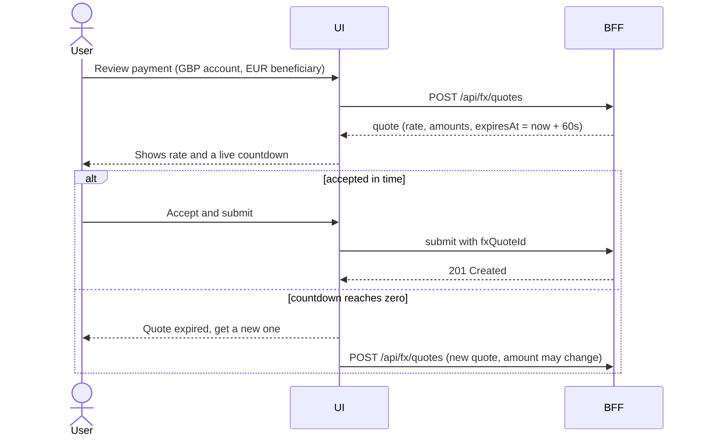
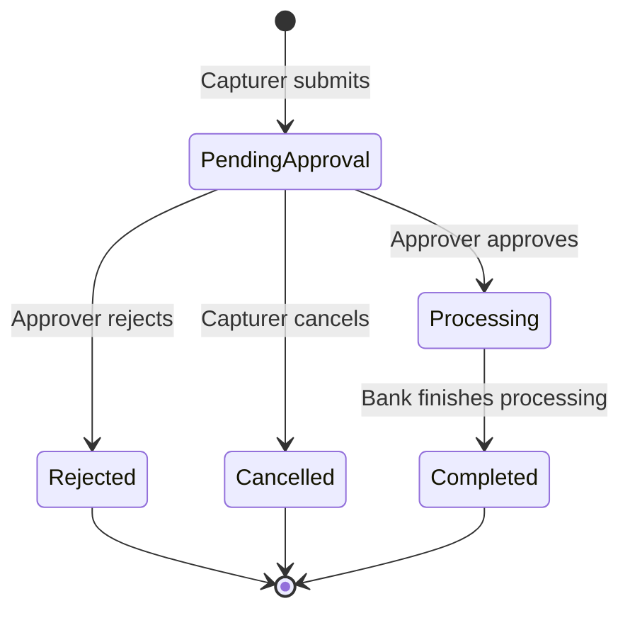
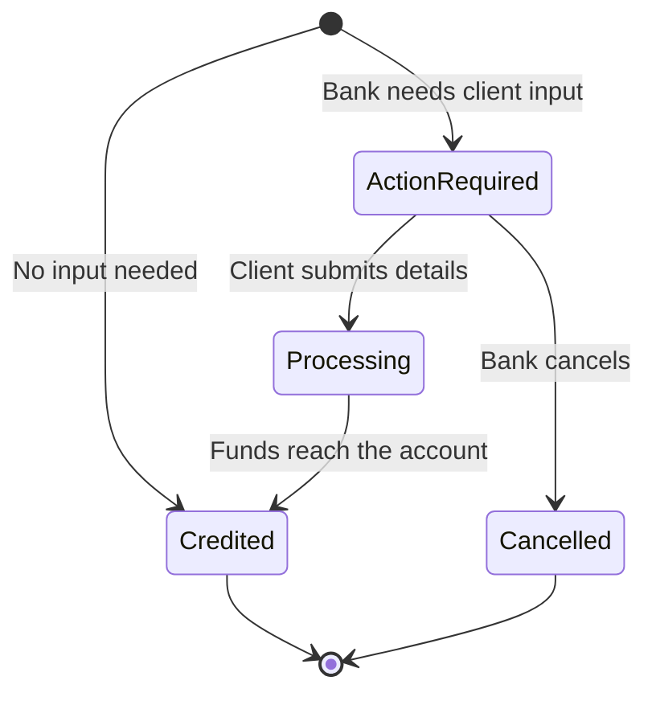

# Domain primer: cross-border business payments

November is a **fictional** online banking portal for business clients of a **fictional** bank, "November Bank". Every company, person, rate and rule in this repository is invented for learning purposes. The domain was chosen because it has just enough real-world complexity (multi-step journeys, time-limited FX quotes, dual approval) to make the architecture worth studying.

The demo company is **Harbourline Trading Ltd**, a business that holds accounts in several currencies and trades with suppliers abroad.

## The three kinds of money movement

| Journey | Direction | Who receives the money |
| --- | --- | --- |
| **International payment** | Outgoing | A third party abroad (a *beneficiary*) |
| **International transfer** | Outgoing | Another account owned by the same company, usually in a different currency |
| **Incoming international payment** | Incoming | The company, sent by someone abroad (the *sender*) |

## Glossary

| Term | Meaning in this app |
| --- | --- |
| Account | A bank account held by the company. Each has a currency, a balance and an available balance. |
| Available balance | What can be spent right now: the balance minus payments that are captured but not yet processed. |
| Account holder | The legal entity that owns the account (here, Harbourline Trading Ltd). |
| Sender | Whoever sends the money. Also called the payer or remitter. |
| Beneficiary | Whoever receives an outgoing payment. Also called the payee. Can be saved for reuse. |
| Account number | Identifies an account at its bank. |
| Sort code | Six-digit UK bank and branch identifier used alongside a UK account number. |
| IBAN | International Bank Account Number, used by countries in the IBAN scheme (most of Europe). Contains a checksum. |
| SWIFT / BIC | Identifies a bank on the international payments network. |
| Routing number | Nine-digit US bank identifier (ABA), used with a US account number. |
| Payment reference | Short free text shown to the receiver, for example an invoice number. Max 35 characters. |
| Purpose code | A code that says *why* money is moving (for example "Goods purchase" or "Professional services"). Banks need it for regulatory reporting. |
| Debit / credit | Money leaving an account is a debit; money arriving is a credit. |
| FX quote | A firm offer to exchange one currency for another at a stated rate. In this app a quote is valid for **60 seconds** and can be used **once**. |
| Sell / buy currency | From the bank client's point of view: the currency leaving their account (sell) and the currency the receiver gets (buy). |
| Capturer (maker) | A company user who enters a payment. Capturing does not move money. |
| Approver (checker) | A different company user who authorises a captured payment so the bank will process it. |
| Four-eyes principle | No single person can both capture and approve the same payment. |

## Who uses the app

Business banking is about teams, not individuals. Harbourline has three portal users:

| Persona | Roles | Why they exist in the demo |
| --- | --- | --- |
| Alex Morgan | Capturer | Captures payments but cannot approve anything. |
| Sam Okafor | Approver | Approves or rejects what others captured. |
| Jordan Reeves | Capturer, Approver | Can do both, but the four-eyes rule still stops them approving their own payments. |

## Journeys

### 1. Pay an existing beneficiary

1. Open **Make a payment** and pick a saved beneficiary.
2. Choose the account to pay from and enter the amount. The amount can be expressed in the account's currency ("send exactly £1,000") or the beneficiary's currency ("they must receive exactly €1,150").
3. Choose a purpose code and enter a reference.
4. Accept the declarations (for example, "the details I have entered are correct").
5. Review. If currencies differ, get an FX quote and accept it while it is still valid.
6. Submit. The payment is now **Pending approval**, and the confirmation screen says so.

### 2. Pay a new beneficiary

The same as journey 1, except the capturer enters the beneficiary's name, country, currency and bank details, and decides whether to save the beneficiary for next time. The bank details asked for depend on the country:

| Country format | Details required |
| --- | --- |
| IBAN countries (DE, FR, NL, IE, ES, CH) | IBAN, SWIFT/BIC |
| United States | Account number, routing number, SWIFT/BIC |
| Other (ZA, JP) | Account number, SWIFT/BIC |

The order of the steps is not fixed. A client may enter the beneficiary first and the account second; the API does not care about step order, only about the final submission.

### 3. International transfer between own accounts

Like an international payment, but the destination is another Harbourline account (for example, GBP Operating to USD Trading). There is no beneficiary and no purpose code. It still needs an FX quote when currencies differ, and it still needs a second person's approval.

### 4. Approve or reject (the checker's journey)

1. An approver opens **Approvals** and sees every payment and transfer that is pending approval.
2. They open one and review the details and the audit timeline.
3. To approve a payment that involves currency conversion they must get a **fresh** FX quote and accept it within 60 seconds. The capturer's quote expired long ago, so the approver commits to the rate that applies right now.
4. Or they reject it with a reason.
5. An approved payment moves to **Processing** and, after a short simulated delay, **Completed**, at which point the account is debited.

The capturer can cancel their own payment while it is still pending approval.

### 5. Respond to an incoming international payment

The sender has already sent the money. The client:

1. Opens **Incoming payments** and sees a list with statuses: **Action required**, **Processing**, **Credited**, **Cancelled**.
2. Opens one to see the sender, amount, currency, receiving account and status.
3. If action is required, provides what the bank asks for:
   - a purpose code (why the money is being received), and/or
   - acceptance of an FX quote when the incoming currency differs from the receiving account's currency.
4. Submits. The payment moves to **Processing** and then, after a simulated delay, **Credited**.

Some incoming payments need nothing from the client and simply arrive as **Credited**.

## FX quotes

Rules:

- A quote is valid for 60 seconds from creation.
- A quote can be used once. Using it consumes it.
- The currency pair and amount on the quote must match the request that uses it.
- An expired, used or mismatched quote is rejected with a clear error, and the UI offers a new quote.

## Status lifecycles

### Outgoing payments and transfers

### Incoming payments

## Assumptions made for this demo

A real product would settle these with the business. Here they are simply decided, so the code has something concrete to implement:

1. Only outgoing money movement (payments and transfers) needs dual approval. Responding to an incoming payment is a single-person action.
2. Saving a new beneficiary takes effect immediately. A real bank would probably make beneficiary creation subject to approval too.
3. The approver, not the capturer, commits to the final FX rate.
4. There are no payment limits, cut-off times or fees.
5. "Processing" is simulated with a short delay (a few seconds) so the full lifecycle can be seen in one sitting.
6. All data is in memory and resets when the BFF restarts.
7. Authentication is mocked: you pick a persona on a login screen. The design leaves a clear seam for a real identity provider.
