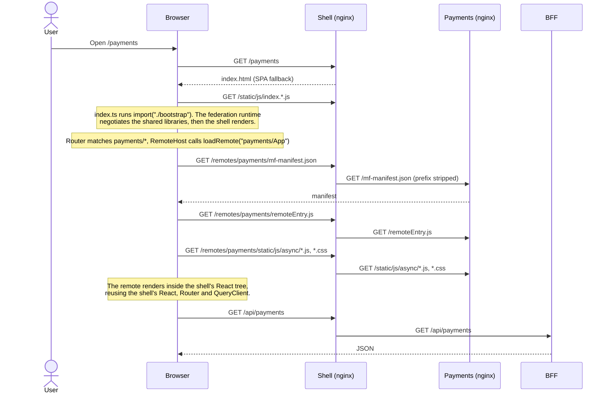

# Front end: React micro frontends

This is the guide to the front end of November, a fictional business-banking portal. It explains what is built, how the pieces fit, and why each choice was made. Everything described here lives in [`frontend/`](../../frontend). The API it talks to is described in [`docs/api-contract.md`](../api-contract.md) and the domain in [`docs/domain.md`](../domain.md).

- [What micro frontends are, and when they are worth it](#what-micro-frontends-are-and-when-they-are-worth-it)
- [Stack](#stack)
- [Repository layout](#repository-layout)
- [Running it](#running-it)
- [How Module Federation works here](#how-module-federation-works-here)
- [Shared singletons and version rules](#shared-singletons-and-version-rules)
- [Routing ownership](#routing-ownership)
- [The shell and remote contract](#the-shell-and-remote-contract)
- [The design system](#the-design-system)
- [Data fetching through the BFF](#data-fetching-through-the-bff)
- [The FX quote countdown](#the-fx-quote-countdown)
- [The journeys](#the-journeys)
- [Error isolation](#error-isolation)
- [Standalone development](#standalone-development)
- [Adding a new micro frontend](#adding-a-new-micro-frontend)
- [Docker and nginx](#docker-and-nginx)
- [Contract notes](#contract-notes)

## What micro frontends are, and when they are worth it

A micro frontend architecture splits one web application into several smaller applications that are built and deployed separately, then composed into one product in the browser. It applies the idea behind microservices to the UI: independent teams, independent release cycles, a boundary you can reason about.

What you get:

- **Independent delivery.** A fix to the approvals journey ships without rebuilding or retesting payments.
- **Failure isolation.** If one piece fails to load, the rest still works.
- **Team autonomy.** Each team owns a workspace, its dependencies and its pipeline.

What it costs:

- More builds, more images, more infrastructure, and a runtime contract between the pieces.
- Shared libraries become a versioning problem (see [Shared singletons and version rules](#shared-singletons-and-version-rules)).
- Visual consistency has to be maintained on purpose.
- Harder debugging, because errors can come from the boundary rather than the code.

The honest rule of thumb: **if one team ships one product on one cadence, a single app with route-level code splitting is simpler and better.** Micro frontends pay off when several teams need to release independently, or when parts of the product have genuinely different lifecycles. This repository uses them on purpose, to teach the mechanics, and applies them to a domain where the split is believable: payments, approvals and incoming payments would plausibly be separate teams in a bank. The decision is recorded in [ADR 0001](../adr/0001-micro-frontends-with-module-federation.md).

## Stack

| Concern | Choice |
| --- | --- |
| Runtime | Node 24 and npm 11 (npm workspaces), see `frontend/.nvmrc` |
| UI | React 19, TypeScript in strict mode, CSS Modules, no UI framework |
| Bundler | Rsbuild 2 with `@rsbuild/plugin-react` |
| Micro frontends | Module Federation 2.0 through `@module-federation/rsbuild-plugin`, `mf-manifest.json` manifests |
| Routing | React Router 8 in declarative (library) mode, imported from `react-router` |
| Server state | TanStack Query 5 |
| Forms | react-hook-form with zod 4 |
| Tests | One small Vitest unit test for the FX countdown logic |
| Container | nginx (unprivileged) |

Versions are the current stable releases at the time of writing and are pinned by `frontend/package-lock.json`.

## Repository layout

```text
frontend/
  package.json            npm workspaces, scripts used by CI: dev, build, typecheck, test
  package-lock.json
  tsconfig.base.json      strict TypeScript settings shared by every workspace
  env.d.ts                CSS Module typings (Rsbuild)
  .nvmrc  .dockerignore  .gitignore
  Dockerfile              one parameterised Dockerfile, build arg APP=shell|payments|approvals|incoming
  README.md
  config/
    rsbuild.ts            defineShell() and defineRemote(): all Rsbuild and Module Federation settings
  nginx/
    shell.conf.template   shell: static files, SPA fallback, /api and /remotes proxies
    remote.conf.template  remotes: static files only
    snippets/             security headers, proxy settings, cache rules shared by both
  packages/
    ui/                   @november/ui: design tokens and accessible components
    shared/               @november/shared: contract types, API client, query keys, events, hooks
  apps/
    shell/                host, dev port 3000
    payments/             remote, dev port 3001
    approvals/            remote, dev port 3002
    incoming/             remote, dev port 3003
```

The workspace packages are consumed as **TypeScript source**. Their `package.json` points `exports` at `src/index.ts`, and because npm links workspaces by symlink and the files are not under `node_modules`, Rsbuild compiles them like application code. There is no separate build step for `ui` or `shared`.

Dependency direction is one way: `apps/*` depend on `@november/shared` and `@november/ui`; `@november/shared` depends on `@november/ui` (only for `StandaloneHost` and `PaymentFacts`); `@november/ui` depends on nothing in the workspace.

## Running it

```bash
cd frontend
npm ci
npm run dev        # shell on :3000, payments :3001, approvals :3002, incoming :3003
```

Open http://localhost:3000. The BFF is expected on http://localhost:5080 (override with `BFF_URL`). `npm run dev` runs the four dev servers with `concurrently --kill-others-on-fail`, so if one crashes they all stop, which is what you want while developing.

| Script | What it does |
| --- | --- |
| `npm ci` | Install exactly what the lockfile says |
| `npm run dev` | Run all four apps |
| `npm run typecheck` | `tsc` in every workspace |
| `npm run build` | `rsbuild build` in every app; each writes `dist/` |
| `npm run test` | The FX countdown unit test |

In development the shell's dev server proxies the same paths nginx proxies in production, so the code path is identical (`config/rsbuild.ts`):

```ts
proxy: { "/api": bff, ...remoteProxies },
```

where each entry of `remoteProxies` looks like `/remotes/payments` to `http://localhost:3001` with `pathRewrite: { "^/remotes/payments": "" }`.

## How Module Federation works here

Module Federation lets one build (the **host**) load code from another, separately built and deployed build (a **remote**) at runtime, and share chosen libraries so they are only loaded once.

The moving parts:

- Each remote **exposes** modules. Ours expose exactly one, `./App`, declared in `defineRemote()` in `config/rsbuild.ts`.
- Each remote build emits `mf-manifest.json` (a description of the remote: its entry file, its exposed modules, its shared libraries and the chunk files each needs) and `remoteEntry.js` (the small script that registers the remote with the runtime).
- The host does not know the remotes at build time. It **registers** them at runtime and loads them on demand.

The shell registers the remotes in `apps/shell/src/remotes.ts`:

```ts
registerRemotes(
  remoteNames.map((name) => ({
    name,
    entry: `${window.location.origin}/remotes/${name}/mf-manifest.json`,
  })),
  { force },
);
```

and loads one with `loadRemote<RemoteModule>(`${name}/App`)`. `apps/shell/src/RemoteHost.tsx` wraps that call in `React.lazy`, so React treats the remote like any other lazily loaded component.

What happens when a user opens `/payments`:



Three details make this work and are worth understanding.

**Async bootstrap.** Every app's entry file is one line (`apps/*/src/index.ts`):

```ts
import("./bootstrap");
```

and the real start-up code lives in `bootstrap.tsx`. Shared libraries have to be negotiated between host and remotes before any code imports them. A dynamic `import()` gives the federation runtime that moment. Without it you get the well-known error "Shared module is not available for eager consumption".

**`publicPath: "auto"`.** A remote does not know the URL it will be served from. In `defineRemote()`:

```ts
output: { assetPrefix: "auto" },
dev: { assetPrefix: "auto", client: { port } },
```

With `auto`, the runtime works out where chunks live from the URL of the script that is running, which is `/remotes/payments/remoteEntry.js`, so chunk URLs come out as `/remotes/payments/static/...`. The same bundle therefore works behind any prefix, which is what lets the shell's nginx strip `/remotes/payments`. `dev.client.port` points the dev server's hot-reload socket at the remote's own port instead of the shell's.

**A `<base>` tag for standalone mode.** A remote's own `index.html` gets `<base href="/">` (`html.tags` in `defineRemote()`). The built HTML uses relative script URLs because of `auto`, and without the tag a deep link such as `localhost:3001/new-beneficiary` would look for its scripts under `/new-beneficiary/static/...`.

The remote's manifest URL is `/remotes/<name>/mf-manifest.json` on the shell's origin in every environment: dev, Docker Compose and Azure. That is the idea behind [ADR 0007](../adr/0007-shell-as-single-entry-point.md).

## Shared singletons and version rules

Four libraries are shared at runtime (`config/rsbuild.ts`):

```ts
const singletons = ["react", "react-dom", "react-router", "@tanstack/react-query"];

function sharedSingletons() {
  const manifest = JSON.parse(readFileSync(resolve(process.cwd(), "package.json"), "utf8"));
  return Object.fromEntries(
    singletons.map((name) => [name, { singleton: true, requiredVersion: manifest.dependencies[name] }]),
  );
}
```

Why these four, and why as singletons:

- **react and react-dom.** Two copies of React in one page break hooks and context. A remote has to render inside the shell's React tree.
- **react-router.** The shell owns the `BrowserRouter`; a remote's `<Routes>` and `<Link>` must see that router's context.
- **@tanstack/react-query.** The shell owns the `QueryClientProvider`. Because the library is a singleton, a remote's `useQuery` reads the shell's cache, so a payment submitted in one remote shows up in the shell's dashboard counters after an invalidation, with no extra plumbing.

Rules:

1. **`requiredVersion` comes from each app's own `package.json`.** An app can only share a library it declares as a dependency.
2. **All four apps declare identical ranges for these four libraries.** npm then installs one copy, and the runtime sees one compatible version.
3. **A mismatch is a warning, not a failure.** With `singleton: true` and no `strictVersion`, the runtime logs a warning and uses the one copy it chose. That keeps a page alive, but it means a bad upgrade is only caught if someone looks, so upgrade these libraries for all four apps in the same change and run them together.
4. **Everything else is bundled per app.** That includes `@november/ui` and `@november/shared`. They are small, stable and versioned together in this repository. Making them federated singletons would add a second versioning problem for little gain. The cost is that the CSS tokens and some helper code appear in four bundles.
5. **React Router is imported from `react-router` only.** There is no `react-router-dom`; it would be a separate package instance.

## Routing ownership

The URL space is split by prefix.

| Prefix | Owner |
| --- | --- |
| `/login`, `/` | Shell |
| `/payments/*` | Payments remote |
| `/approvals/*` | Approvals remote |
| `/incoming/*` | Incoming remote |

The shell declares each prefix once (`apps/shell/src/App.tsx`):

```tsx
<Route path="payments/*" element={<RemoteHost name="payments" title="Payments" />} />
```

Everything after the prefix belongs to the remote, which declares **relative** routes (`apps/payments/src/App.tsx`):

```tsx
<Routes>
  <Route index element={<PaymentsHubPage />} />
  <Route path="beneficiary" element={<PaymentWizard mode="saved" />} />
  <Route path="new-beneficiary" element={<PaymentWizard mode="new" />} />
  <Route path="transfer" element={<PaymentWizard mode="transfer" />} />
  <Route path=":paymentId" element={<PaymentDetailPage />} />
</Routes>
```

A nested `<Routes>` inside a splat route is matched against what is left of the URL, so the remote has no idea it lives under `/payments`.

For **links**, a remote builds URLs from the `basePath` it was given, through `useRemote().href` (`packages/shared/src/remote.tsx`):

```tsx
const { href } = useRemote();
<Link to={href(payment.id)}>{payment.payeeName}</Link>
```

`href("")` is the remote's root, `href("beneficiary")` is `/payments/beneficiary` when mounted by the shell and `/beneficiary` when standalone. Explicit absolute paths are used on purpose: relative `<Link>` resolution depends on where a link sits in the route tree, which is easy to get wrong in nested routes.

## The shell and remote contract

The boundary between shell and remotes is small and explicit. There are exactly four channels.

### 1. Props

```ts
export type RemoteAppProps = {
  basePath: string;
  session: Session;
};
```

The shell passes the mount prefix and the signed-in session. A remote's `App` wraps itself in `RemoteProvider`, which exposes both through `useRemote()` (`basePath`, `session`, `href()`, `hasRole()`). The session is passed down rather than fetched again, so remotes never disagree with the shell about who is signed in.

### 2. Events

Remotes tell the shell about things it cares about using typed `CustomEvent`s on `window` (`packages/shared/src/events.ts`):

| Event | Detail | Emitted by | Reaction |
| --- | --- | --- | --- |
| `november:session-expired` | none | `apiFetch` on any `401` (not for the session and login calls themselves) | Shell clears cached data and the route guard sends the user to `/login`. `StandaloneHost` does the same |
| `november:payment-submitted` | `{ paymentId }` | Payments, after a successful submit | Shell invalidates the dashboard |
| `november:payment-decided` | `{ paymentId, outcome }` where outcome is `Processing`, `Rejected` or `Cancelled` | Approvals (approve, reject), Payments (cancel) | Shell invalidates the dashboard |
| `november:incoming-responded` | `{ incomingId }` | Incoming, after a successful respond | Shell invalidates the dashboard |

```ts
emit("november:payment-submitted", { paymentId: payment.id });
const off = on("november:payment-submitted", ({ paymentId }) => console.log(paymentId));
```

Events are used where the shell needs to react but must not know how a remote works. Each remote keeps its own caches fresh itself by invalidating its own query keys.

### 3. URLs

Remotes link to each other, and the shell links to remotes, only by URL. For example the dashboard links to `/incoming?status=ActionRequired` and `/payments/<id>`. A URL is a contract that survives a rewrite on either side.

### 4. The BFF

Anything else one remote needs to know comes from the API, which is the single source of truth. There is no shared in-browser state beyond the query cache.

### Why remotes never import each other

If `approvals` imported a component from `payments`, the two would have to be built, versioned and deployed together, which removes the reason for having two apps. It would also create a hidden runtime dependency: approvals would break whenever payments was down. Shell and remotes depend on the contract above, and on the two shared workspace packages, and on nothing else. If two remotes need the same thing, it moves into `@november/shared` or `@november/ui` (as `PaymentFacts` did, because both payments and approvals show the same payment details).

## The design system

`@november/ui` (`frontend/packages/ui`) is a small, framework-free design system: design tokens as CSS custom properties, plus accessible React components styled with CSS Modules.

Tokens (`packages/ui/src/tokens.css`) are named `--n-*`: colours (surface, text, primary, header and status tones), type scale, spacing, radii, shadows and the focus ring. Components only use tokens, never literals, so a re-theme is one file.

| Component | Notes |
| --- | --- |
| `Button`, `buttonClassName` | Variants `primary`, `secondary`, `danger`, `ghost`; loading state sets `aria-busy`. `buttonClassName()` styles a router `<Link>` as a button without making `ui` depend on the router |
| `Card`, `PageHeader`, `EmptyState`, `Spinner` | Layout and feedback. Spinner is `role="status"` with a label |
| `TextInput`, `TextArea`, `Select`, `Checkbox`, `Field` | `Field` generates the `id`, links the `<label>`, and wires hint and error text through `aria-describedby`, `aria-invalid` and `aria-required`. The inputs forward `ref`, so they work directly with react-hook-form's `register` |
| `Stepper` | Ordered list; the current step has `aria-current="step"` |
| `Alert` | `role="alert"` for warnings and errors, `role="status"` for information and success |
| `StatusBadge`, `Chip` | Maps payment and incoming statuses to a tone and a readable label ("Pending approval") |
| `MoneyAmount`, `formatMoney` | `Intl.NumberFormat` with the currency's decimals (JPY has none) |
| `FxQuotePanel` | Presentational: rate, amounts, countdown, expired state. See [The FX quote countdown](#the-fx-quote-countdown) |
| `DataTable`, `DescriptionList`, `Timeline`, `FilterTabs` | Table with a caption and a scrollable region, key/value list, audit timeline, and a filter group built from `aria-pressed` buttons |

Accessibility basics applied throughout: visible `:focus-visible` outline on every interactive element (`styles.css`), 44px default control height, colour never the only signal (statuses always carry text), `prefers-reduced-motion` respected, and the wizard moves focus to the step heading when the step changes. The layout is responsive down to phone width: grids use `auto-fit`, tables scroll inside their own region, and the navigation scrolls horizontally.

## Data fetching through the BFF

All server data goes through one thin client, `apiFetch` (`packages/shared/src/api/client.ts`):

- always `credentials: "same-origin"`, so the HttpOnly session cookie is sent;
- adds `X-CSRF: 1` to every non-GET request, as the BFF requires;
- parses an RFC 9457 `ProblemDetails` error body into a typed `ApiError` carrying `status`, `code` and `fieldErrors`;
- a `401` emits `november:session-expired`;
- a network failure becomes an `ApiError` with code `network_error`; a `5xx` without a problem body becomes "The service is temporarily unavailable".

Typed functions for every endpoint live in `api/endpoints.ts` (`api.getDashboard()`, `api.approvePayment(id, fxQuoteId)` and so on), query keys in `api/queryKeys.ts`, and ready-made TanStack Query options in `api/queries.ts`:

```ts
payments: (filter: PaymentFilter = {}) =>
  queryOptions({ queryKey: queryKeys.payments.list(filter), queryFn: () => api.listPayments(filter) }),
```

Pages then read:

```tsx
const payments = useQuery(queries.payments({ status: "PendingApproval" }));
```

Why this shape:

- **The BFF returns what the screen needs** (see [ADR 0002](../adr/0002-backend-for-frontend.md)), so there is no client-side joining. The dashboard is one call, and payments carry `canApprove` and `canCancel`, so the UI shows what the server says rather than re-implementing rules.
- **`queryOptions` factories** keep the key and the fetcher together and mean the shell and a remote can share a cache entry by using the same factory. The shell's navigation badges and the dashboard both read `queries.dashboard()`.
- **One `QueryClient`**, created by `createQueryClient()` (`packages/shared/src/queryClient.ts`) in the shell, shared with remotes through the React-Query singleton. It does not retry `4xx` responses, because retrying a validation or authorisation error never helps.
- **Polling where the server changes state by itself.** The BFF simulates processing with a short delay, so detail pages poll while a payment is `Processing`:

```tsx
refetchInterval: (query) => (query.state.data?.status === "Processing" ? 2000 : false),
```

  The incoming detail page does the same until the payment is `Credited`, and the lists poll while any row is `Processing`.
- **Mutations invalidate what they touch** (`queryKeys.payments.all`, `queryKeys.accounts`) and emit an event for the shell.

## The FX quote countdown

An FX quote is valid for 60 seconds and can be used once ([domain primer](../domain.md#fx-quotes)). The UI has to make that visible and recoverable. The logic is in two places.

**Pure logic** (`packages/shared/src/fxQuote.ts`, covered by the unit test `fxQuote.test.ts`):

```ts
export function quoteDeadline(quote: QuoteTiming, receivedAtMs: number): number {
  const lifetimeMs = Date.parse(quote.expiresAt) - Date.parse(quote.createdAt);
  const validForMs = Number.isFinite(lifetimeMs) && lifetimeMs > 0 ? lifetimeMs : quote.validForSeconds * 1000;
  return receivedAtMs + validForMs;
}

export function secondsRemaining(deadlineMs: number, nowMs: number): number {
  return Math.max(0, Math.ceil((deadlineMs - nowMs) / 1000));
}
```

The countdown starts from `expiresAt`, but measured as a duration (`expiresAt - createdAt`) added to the moment the browser received the quote. That makes it immune to a user's clock being minutes wrong, which a naive `expiresAt - Date.now()` is not.

**The hook** (`packages/shared/src/useFxQuote.ts`) keeps the held quote and its deadline, ticks every 250 ms until the deadline, and returns:

| Field | Meaning |
| --- | --- |
| `quote`, `secondsLeft`, `expired` | What to show |
| `pending`, `error` | Request state |
| `request(req)` | Get a quote for `{ sellCurrency, buyCurrency, amount, fixedSide }` |
| `refresh()` | Repeat the last request ("Get a new quote") |
| `markExpired()` | Force the expired state, used when the server answers `fx_quote_expired`, `_used` or `_mismatch` |
| `clear()` | Drop the quote |

Only the latest request wins, so a slow response for an old request cannot overwrite a newer quote.

**The panel** (`FxQuotePanel` in `@november/ui`) is purely presentational. It shows the rate and both amounts, a progress bar and `Rate valid for 0:42`, and when the countdown reaches zero it switches to a warning with a **Get a new quote** button. For assistive technology the visible timer is `role="timer"` with `aria-live="off"`, so a screen reader is not interrupted every second. A separate visually hidden `aria-live="polite"` region announces only when the state changes: rate locked, under 30 seconds, under 10 seconds, expired.

Three screens use the same hook and panel:

| Screen | Quote request |
| --- | --- |
| Payments, review step | Sell currency is the source account's, buy currency is the destination's, fixed side follows which currency the user typed the amount in |
| Approvals, approve | A **fresh** quote, same pair, same fixed side and amount as the capture (see [Contract notes](#contract-notes)). The approver commits to today's rate |
| Incoming, respond | Sells the incoming currency, buys the credit account's currency, fixes the sell side to the incoming amount |

In each, the submit button is disabled while there is no quote, while one is loading and once it has expired. If the server still rejects a quote, `markExpired()` puts the panel into the expired state and the user can ask for a new one.

## The journeys

| Journey | Where | Notes |
| --- | --- | --- |
| Hub, payments list, detail, cancel | `apps/payments/src/pages/` | Hub has three entry cards and a status-filtered list; detail polls while `Processing`; Cancel appears when `canCancel` |
| Pay a saved beneficiary, pay a new beneficiary, international transfer | `apps/payments/src/wizard/` | One wizard component, three modes |
| Pending list, review, approve, reject | `apps/approvals/src/` | Own captures are flagged; actions are disabled with an explanation when `canApprove` is false |
| Incoming list, detail, respond | `apps/incoming/src/` | The form shows only what `actionsRequired` asks for |

### The payment wizard

`PaymentWizard.tsx` loads reference data (accounts, beneficiaries, countries, currencies, purpose codes) then renders the form. Four steps per mode, one `react-hook-form` instance across them:

| Mode | Step 1 | Step 2 | Step 3 | Step 4 |
| --- | --- | --- | --- | --- |
| Saved beneficiary | Choose beneficiary | From account, amount, amount currency | Purpose, reference, declarations | Review, quote, submit |
| New beneficiary | Name, country, currency, bank fields, save toggle | as above | as above | as above |
| Transfer | From and to account | Amount, amount currency | Reference, declarations | Review, quote, submit |

Design points:

- **Per-step validation.** `form.trigger(stepFields[mode][step])` validates only the current step's fields against one zod schema (`validation.ts`). Order between steps is not enforced by the API, only the final submission is.
- **The bank fields follow the country.** `Country.bankDetailsFormat` decides whether the form asks for an IBAN, an account number and SWIFT/BIC, or an account number, routing number and SWIFT/BIC. IBANs are checked with the mod-97 checksum and must start with the chosen country code.
- **Amount in either currency.** The "Amount is in" select offers the account's currency and the beneficiary's, and that choice decides `fixedSide` (`routing.ts`). The payload sends `amount` and `currency` exactly as the contract's rules require.
- **Quote only when currencies differ.** The review step requests a quote when it appears (and only then, guarded so React Strict Mode does not request twice) and discards it when the user goes back, because the amount may change and a quote must match the amount.
- **Confirmation** says "Pending approval" and explains that a second person must approve.

## Error isolation

Failures are contained at four levels:

1. **Network edge.** The shell's nginx gives remote requests a short connect timeout (3 seconds), so a remote that is down fails fast with a `502` or `504` for that remote's files only.
2. **Loading a remote.** If the manifest or a chunk cannot be fetched, the federation runtime rejects, `React.lazy` rethrows, and the shell's `RemoteBoundary` (`apps/shell/src/RemoteBoundary.tsx`) catches it.
3. **A friendly fallback.** `RemoteHost` shows a message and a **Try again** button, with the technical error tucked into a `<details>`. The header and navigation are outside the boundary and keep working, and the other remotes are unaffected.
4. **Retry.** Try again increments a counter that creates a fresh lazy component and re-registers the remotes with `force: true`, so a remote that has come back is picked up without reloading the page.

```tsx
const Remote = useMemo(() => lazy(() => loadRemoteApp(name, attempt > 0)), [name, attempt]);
```

Rendering errors inside a remote are caught by the same boundary. Data errors never reach it: every page handles its own query errors with an inline alert and a retry button.

## Standalone development

Each remote runs on its own, so a team does not need the shell. `bootstrap.tsx` in every remote does:

```tsx
<StandaloneHost name="Payments">{(props) => <App {...props} />}</StandaloneHost>
```

`StandaloneHost` (`packages/shared/src/components/StandaloneHost.tsx`) supplies what the shell normally provides: a `QueryClientProvider`, a `BrowserRouter`, a session check against `/api/session`, a small persona picker if you are not signed in, and a thin top bar. The remote is mounted at the root with `basePath: ""`.

```bash
npm run dev -w @november/payments     # then open http://localhost:3001
```

Each remote's dev server also proxies `/api` to the BFF, so it works as soon as the BFF is running.

Standalone mode is also how you check that a remote does not secretly depend on the shell: if it works at `localhost:3001`, it only needs the contract.

## Adding a new micro frontend

The example adds a "statements" remote on port 3004. Replace the names as needed.

1. **Create the workspace.** Copy `apps/incoming` to `apps/statements`. In its `package.json` set the name to `@november/statements`. Keep the four shared libraries on the **same version ranges** as the other apps (see [Shared singletons and version rules](#shared-singletons-and-version-rules)).
2. **Configure it.** In `apps/statements/rsbuild.config.ts`:

   ```ts
   export default defineRemote({ name: "statements", title: "Statements" });
   ```

   and add `statements: 3004` to `remotePorts` in `config/rsbuild.ts`. The shell's dev proxy is generated from that table, so nothing else changes there.
3. **Write the app.** `src/App.tsx` is a default export taking `RemoteAppProps`, wrapped in `RemoteProvider`, with relative `<Routes>` and links built with `useRemote().href()`. Keep `src/index.ts` (`import("./bootstrap")`) and `src/bootstrap.tsx` as copied.
4. **Register it in the shell.**
   - `apps/shell/src/remotes.ts`: add `"statements"` to `RemoteName` and `remoteNames`.
   - `apps/shell/src/App.tsx`: add `<Route path="statements/*" element={<RemoteHost name="statements" title="Statements" />} />`.
   - `apps/shell/src/Layout.tsx`: add a nav item.
5. **Wire the scripts.** Add a `concurrently` entry for `npm run dev -w @november/statements` in the root `package.json`, then run `npm install` so the workspace is linked and the lockfile updated.
6. **Containerise it.** Add `COPY apps/statements/package.json apps/statements/` to the `deps` stage of `frontend/Dockerfile`. The image builds with `--build-arg APP=statements` and needs no other change.
7. **Route to it in production.** In `nginx/shell.conf.template` add `set $statements_upstream ${STATEMENTS_UPSTREAM};` and a `location /remotes/statements/` block modelled on the others. Add `STATEMENTS_UPSTREAM` to the `NGINX_ENVSUBST_FILTER` regex and the defaults in the Dockerfile, and set it on the shell container wherever the stack is defined.
8. **Verify.** `npm run typecheck`, `npm run build`, and check `apps/statements/dist/mf-manifest.json` and `remoteEntry.js` exist.

## Docker and nginx

One Dockerfile builds every app (`frontend/Dockerfile`), selected by `--build-arg APP=`:

```bash
docker build --build-arg APP=shell      -t november-shell      frontend
docker build --build-arg APP=payments   -t november-payments   frontend
docker build --build-arg APP=approvals  -t november-approvals  frontend
docker build --build-arg APP=incoming   -t november-incoming   frontend
```

Stages:

| Stage | Does |
| --- | --- |
| `deps` | Copies only the `package.json` files and the lockfile, then `npm ci` for that one workspace (`--workspace=apps/$APP --include-workspace-root`). This layer is cached until dependencies change |
| `build` | Copies the source and runs `npm run build --workspace=apps/$APP` |
| `runtime` | `nginxinc/nginx-unprivileged:stable-alpine`, listening on 8080, as a non-root user. Copies the built `dist/` and the right nginx template |

Because remotes are loaded at runtime, **the shell does not need the remotes to build**, and each image builds in isolation.

### How the nginx configuration is produced

The nginx image can expand environment variables in files under `/etc/nginx/templates/*.template` at start-up. The Dockerfile copies `shell.conf.template` for `APP=shell` and `remote.conf.template` for everything else to `/etc/nginx/templates/default.conf.template`.

Substitution is deliberately restricted, otherwise it would also replace nginx's own `$variables` such as `$uri` and `$host`:

```dockerfile
NGINX_ENVSUBST_FILTER="^(BFF|PAYMENTS|APPROVALS|INCOMING)_UPSTREAM\$|^NGINX_LOCAL_RESOLVERS\$"
NGINX_ENTRYPOINT_LOCAL_RESOLVERS=1
```

`NGINX_ENVSUBST_FILTER` limits substitution to the variables that match. `NGINX_ENTRYPOINT_LOCAL_RESOLVERS` makes the entrypoint export `NGINX_LOCAL_RESOLVERS` from `/etc/resolv.conf`, so the same image uses Docker's DNS in Compose and the platform's DNS in Azure Container Apps.

### What every app serves

| Path | Behaviour |
| --- | --- |
| `/healthz` | `200 ok`, not logged. Used by container health checks |
| `/index.html`, `/mf-manifest.json`, `/remoteEntry.js` | `Cache-Control: no-cache`, because they are the pointers that name the current build |
| `/static/*` | `Cache-Control: public, max-age=31536000, immutable`; file names contain a content hash |
| everything | `X-Content-Type-Options: nosniff`, `Referrer-Policy: strict-origin-when-cross-origin`, `Content-Security-Policy: frame-ancestors 'none'` |

The `include` of `snippets/security-headers.conf` is repeated in each `location` that sets its own `add_header`, because nginx does not inherit `add_header` into a location that defines any.

### What the shell adds

`nginx/shell.conf.template`:

```nginx
set $payments_upstream ${PAYMENTS_UPSTREAM};

location /remotes/payments/ {
    rewrite ^/remotes/payments/(.*)$ /$1 break;
    proxy_pass $payments_upstream;
    include /etc/nginx/snippets/proxy-common.conf;
}
```

- **SPA fallback.** Unknown paths serve `index.html`, so deep links like `/approvals/pay_123` work.
- **`/api/`** proxies to `$BFF_UPSTREAM`.
- **`/remotes/<name>/`** proxies to `$<NAME>_UPSTREAM` with the prefix stripped by `rewrite ... break`.
- **Upstreams are resolved per request.** Using a variable in `proxy_pass` together with `resolver` means nginx does not need the upstreams to exist when it starts. Without that, a remote that was not yet deployed would stop the whole shell from starting, which defeats [error isolation](#error-isolation).
- **The default `Host` header is kept** (`proxy_set_header Host $proxy_host`), meaning the upstream's own host name. Azure Container Apps routes internal traffic by `Host`, so forwarding the browser's `Host` would send the request to the wrong app.
- **Forwarded headers.** `X-Forwarded-For`, `X-Forwarded-Host`, and `X-Forwarded-Proto` (taken from an incoming `X-Forwarded-Proto` if a load balancer already set it, otherwise from the scheme).
- **Upstream security headers are hidden** (`proxy_hide_header`), so the shell's policy is the only one the browser sees, with no duplicates.

### Configuration

| Variable | Default in the image | Example in Azure Container Apps |
| --- | --- | --- |
| `BFF_UPSTREAM` | `http://bff:8080` | `http://<bff-app-name>` |
| `PAYMENTS_UPSTREAM` | `http://payments:8080` | `http://<payments-app-name>` |
| `APPROVALS_UPSTREAM` | `http://approvals:8080` | `http://<approvals-app-name>` |
| `INCOMING_UPSTREAM` | `http://incoming:8080` | `http://<incoming-app-name>` |

The defaults match the service names you would use in Docker Compose. Only the shell reads these; the remotes' image has no variables.

## Contract notes

The front end is built against [`docs/api-contract.md`](../api-contract.md). Two small points are worth knowing.

- **`PaymentDetail.fixedSide`.** Approving a payment that involves FX needs a fresh quote for the same pair, fixed side and amount as the capture. The BFF therefore returns `fixedSide: "Sell" | "Buy"` on every `PaymentDetail`, and `approvalQuoteRequest()` in `apps/approvals/src/rules.ts` reads it directly. It started life as an optional field that the front end inferred from the amounts and the accepted rate; once the BFF sent it, the inference was deleted.
- **React Router 8.** The brief for this repository named React Router 7. The current stable release at the time of writing is 8, and the declarative `BrowserRouter`, `Routes` and `Route` API used here is unchanged, so the code follows the same pattern.
