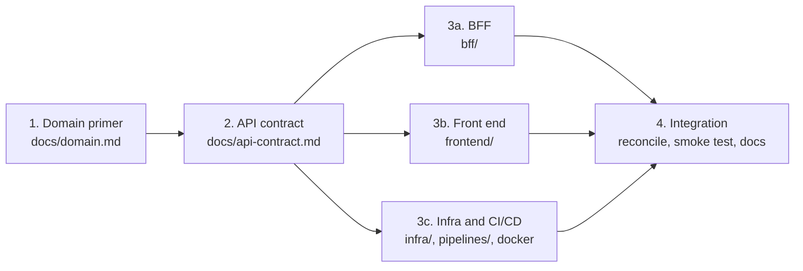

# How it was built

This is an engineering narrative: the order the work was done in, why that order, the commands that produce the skeleton, the decisions that mattered, and the problems that bit. It is written so you can build something similar in the same order, and avoid the same potholes.

## The build order



### 1. Domain primer first

[`domain.md`](domain.md) was written before any code. Business banking has vocabulary that is easy to get subtly wrong (sell and buy currency, capturer and approver, available balance), and three teams were about to build against it. Writing the glossary, the journeys and the status lifecycles once meant nobody had to guess, and the diagrams in it became the acceptance criteria.

It also fixed the scope. Decisions like "only outgoing payments need dual approval" and "quotes last 60 seconds and are single use" are written down as assumptions, not discovered in code.

### 2. Contract first

[`api-contract.md`](api-contract.md) came second. It lists every endpoint, request and response type, enum value and error code. With it in hand the front end, the BFF and the infrastructure could be built at the same time by different people without waiting for each other:

- The BFF built the endpoints to the contract and tested them with `curl` and an HTTP-level test.
- The front end wrote its types in `packages/shared/src/types.ts` straight from the contract's TypeScript block, and built every screen against those types.
- Infra and CI/CD needed only the container shape: five images, port 8080, `/healthz` for the front end and `/health/live` and `/health/ready` for the BFF, and the four upstream environment variables.

A contract written in prose and TypeScript notation is cheap to change while it is still only a document. That is the point of doing it first.

### 3. Three parts in parallel

Each part had a clear brief and its own guide:

| Part | Built | Guide | ADRs |
| --- | --- | --- | --- |
| BFF | Minimal APIs, mediator, vertical slices, in-memory fakes that own the business rules, mock auth | [`bff/README.md`](bff/README.md) | [0002](adr/0002-backend-for-frontend.md), [0003](adr/0003-mediator-pattern.md), [0004](adr/0004-vertical-slice-architecture.md), [0005](adr/0005-maker-checker-and-fx-requote.md), [0006](adr/0006-in-memory-downstream-and-mock-auth.md) |
| Front end | Shell and three remotes, design system, shared API client, payment wizard, FX countdown | [`frontend/README.md`](frontend/README.md) | [0001](adr/0001-micro-frontends-with-module-federation.md), [0007](adr/0007-shell-as-single-entry-point.md) |
| Infra and CI/CD | Dockerfiles, nginx templates, Compose, Bicep modules, Azure Pipelines, GitHub mirror | [`infra/README.md`](infra/README.md), [`infra/docker.md`](infra/docker.md), [`infra/ci-cd.md`](infra/ci-cd.md) | [0008](adr/0008-azure-container-apps.md), [0009](adr/0009-bicep-for-infrastructure-as-code.md), [0010](adr/0010-azure-pipelines-for-ci-cd.md) |

Working in parallel against a document means the parts are not tested against each other until the end. That is the cost, and it is why step 4 exists.

### 4. Integration

The last pass joined the parts and checked the seams:

- **Contract reconciliation.** The front end's types and the BFF's response records were compared field by field, and the contract was rewritten to describe what the BFF really does (error codes, omitted nulls, `traceId`, which endpoints need sign-in).
- **A full-stack container run.** `docker compose up --build`, then the whole journey with `curl` through the shell's origin: sign in, dashboard, quote, payment, approval, processing, completion.
- **Documentation.** The top-level README, the architecture page, this page and the indexes were written last, from the code as it stands.

What this pass found, in order of how much it would have hurt:

| Finding | Fix |
| --- | --- |
| The BFF test command in both CI definitions only works from inside `bff/`, because that is where `global.json` switches on the new test runner. | Both pipelines run it from `bff/` with `dotnet test --solution`, and the TRX option was corrected. |
| `fixedSide` was on the quote request but not on the payment, so approvals had to guess it. | The BFF returns it on `PaymentDetail`, the front end reads it, the contract documents it. |
| The contract was behind the BFF: three extra error codes, omitted `null` properties, `traceId`, sign-in required for reference data, `404` for an unknown quote id, `reference` required, `actionsRequired` empty after a response. | [`api-contract.md`](api-contract.md) now describes what the BFF does. No type, name or enum mismatches were found between `packages/shared/src/types.ts` and the BFF records. |
| The container guide said Compose's `depends_on` was needed because nginx resolves upstreams at start-up. The shell resolves them per request, so it starts without them. | Verified by starting the shell with no BFF (it serves the app and returns `502` only for `/api/`), and the guide was corrected. |

Everything else held up when exercised through the shell's origin: `/healthz`, the three federation manifests and a script asset behind the proxy, the persona list, sign-in with a cookie jar, the dashboard, an FX quote, a beneficiary payment, a fresh quote and approval by Sam, `Processing` then `Completed` after the simulated delay, and an incoming payment response. A headless browser also rendered `/payments`, `/approvals` and `/incoming` through the shell, with the remotes loaded at runtime and no console errors.

## Commands that produce the skeleton

These are the commands that produce this repository's skeleton. The code after them is the interesting part, but a clean start saves time.

### BFF

```bash
mkdir bff && cd bff
dotnet new globaljson --sdk-version 10.0.100 --roll-forward latestFeature
dotnet new sln --format slnx --name November.Bff
dotnet new web --name November.Bff.Api --output src/November.Bff.Api
dotnet new install xunit.v3.templates
dotnet new xunit3 --name November.Bff.Tests --output tests/November.Bff.Tests
dotnet sln add src/November.Bff.Api tests/November.Bff.Tests
dotnet add tests/November.Bff.Tests reference src/November.Bff.Api
```

Package versions then live in one place, `Directory.Packages.props` (central package management), and shared compiler settings (nullable, warnings as errors) in `Directory.Build.props`. The runtime packages are `Mediator.Abstractions`, `Mediator.SourceGenerator`, `FluentValidation`, `Microsoft.AspNetCore.OpenApi`, `Scalar.AspNetCore` and `Azure.Monitor.OpenTelemetry.AspNetCore`.

### Front end

```bash
mkdir frontend && cd frontend
npm init -y
npm pkg set private=true type=module "workspaces[0]=apps/*" "workspaces[1]=packages/*"
npm install -D @rsbuild/core @rsbuild/plugin-react @module-federation/rsbuild-plugin typescript vitest concurrently
npm install -w apps/shell react react-dom react-router @tanstack/react-query @module-federation/enhanced
```

Each app and package then gets its own `package.json` (`@november/shell`, `@november/payments`, `@november/approvals`, `@november/incoming`, `@november/ui`, `@november/shared`). One `config/rsbuild.ts` exports `defineShell()` and `defineRemote()`, so all federation settings live in one file.

### Infrastructure

```bash
az bicep install
az bicep build --file infra/main.bicep --stdout
az bicep build-params --file infra/main.dev.bicepparam --stdout
az bicep build-params --file infra/main.prod.bicepparam --stdout
```

These are also the CI checks. The templates are compiled but never deployed from this repository.

### The whole system

```bash
docker compose up --build
```

## Key decisions

The decisions that shaped the system are in the ADRs. The ones people usually ask about:

| Decision | Why | ADR |
| --- | --- | --- |
| Module Federation for the front end | To demonstrate independent delivery of journeys, with the costs written down honestly. | [0001](adr/0001-micro-frontends-with-module-federation.md) |
| A BFF instead of calling services from the browser | UI-shaped endpoints, one error format, the session cookie in one place. | [0002](adr/0002-backend-for-frontend.md) |
| martinothamar/Mediator, not MediatR | Same programming model, source-generated, and avoids the commercial licence the best-known library moved to. | [0003](adr/0003-mediator-pattern.md) |
| Vertical slices, one file per use case | A change touches one file, and a new reader finds everything about a use case together. | [0004](adr/0004-vertical-slice-architecture.md) |
| The approver commits to a fresh FX quote | The rate that applies is the one the approver saw, not one that expired long ago. | [0005](adr/0005-maker-checker-and-fx-requote.md) |
| Fakes own the rules, the BFF orchestrates | A real platform would own them, and the BFF would only translate. | [0006](adr/0006-in-memory-downstream-and-mock-auth.md) |
| The shell is the single entry point | One origin, no CORS, one public surface. | [0007](adr/0007-shell-as-single-entry-point.md) |
| Azure Container Apps | Five small stateless HTTP containers are exactly its sweet spot. | [0008](adr/0008-azure-container-apps.md) |
| Hand-written Bicep modules | Short enough to read in one sitting. Azure Verified Modules are the production recommendation. | [0009](adr/0009-bicep-for-infrastructure-as-code.md) |
| Azure Pipelines as the CI/CD reference | The real-world target is Azure DevOps. GitHub Actions only keeps the public mirror green. | [0010](adr/0010-azure-pipelines-for-ci-cd.md) |

## Pitfalls and how they were solved

### xUnit v3 needs the new test runner

xUnit v3 test projects are executables that run on Microsoft.Testing.Platform. The .NET 10 SDK no longer drives such projects through the old VSTest target, and `dotnet test` stops with an error pointing at the new experience.

The fix is one line in `bff/global.json`: `"test": { "runner": "Microsoft.Testing.Platform" }`. Two consequences followed. First, `global.json` is only found from the current folder upwards, so the tests must be run from `bff/`: `cd bff && dotnet test --solution November.Bff.slnx`. Running `dotnet test bff/November.Bff.slnx` from the repository root fails. The integration pass found this because the CI definitions had been written with the root-relative command, and both CI definitions now run from `bff/`. Second, TRX output uses xUnit's own option, `--report-xunit-trx`, not the VSTest `--logger trx`.

### Package versions drift unless they are pinned

The ASP.NET Core packages (`Microsoft.AspNetCore.OpenApi`, `Microsoft.AspNetCore.Mvc.Testing`) have to track the runtime's 10.0 line, and the OpenAPI generator is the one whose output the contract depends on. All versions are therefore pinned exactly in `Directory.Packages.props` with central package management, so a restore on a laptop, in CI and in the Docker build resolves the same packages. `TreatWarningsAsErrors` is on, with the NuGet vulnerability warnings (`NU1901` to `NU1904`) excluded so an advisory published tomorrow does not break yesterday's build.

### Cookie authentication wants to redirect

By default, cookie authentication answers an unauthenticated request with a redirect to a login page. That is useless to `fetch`, which follows the redirect and hands your code an HTML page. The cookie events in `AuthExtensions` return `401` and `403` instead, and `UseStatusCodePages` plus the problem details service fill the empty body with a `ProblemDetails`.

A related detail: authorization runs before endpoint filters, so an unauthenticated POST without the CSRF header gets `401`, not `400`. The contract now says so.

### Container Apps routes by the Host header

Locally, nginx proxying to `http://bff:8080` works with any `Host` header, so a mistake here is invisible. In Azure Container Apps, internal traffic is routed by the HTTP `Host` header at the environment's ingress. If the shell's nginx forwards the browser's host, the ingress does not know which app the request is for and rejects it.

The fix is `proxy_set_header Host $proxy_host;` in `nginx/snippets/proxy-common.conf`, which sends the upstream's own host name. It works in Compose too, so the local and cloud paths are the same. The browser's original host is preserved in `X-Forwarded-Host`.

### nginx and variables

Three nginx behaviours, all in `frontend/nginx/` and `frontend/Dockerfile`:

- **Template substitution eats nginx's own variables.** The nginx image substitutes every `$variable` in `*.template` files, which would also replace `$uri` and `$host`. `NGINX_ENVSUBST_FILTER` limits substitution to the four `*_UPSTREAM` variables and the resolver.
- **Static upstream names stop nginx from starting.** nginx resolves names in `proxy_pass` when it starts, so a remote that was not deployed yet would crash the whole shell. The shell sets the upstream into a variable and configures a `resolver`, which makes nginx resolve per request. A missing remote then fails only its own requests, which is what the error boundary in the shell expects. `NGINX_ENTRYPOINT_LOCAL_RESOLVERS=1` makes the same image pick up Docker's DNS in Compose and the platform's DNS in Azure.
- **`add_header` is not inherited.** A `location` that sets any header drops all the headers set above it. The security headers snippet is included again in every such location.

### Chiseled images cannot run HEALTHCHECK

The BFF's runtime image is the chiseled (distroless-style) .NET image: no shell, no package manager, non-root. A Dockerfile `HEALTHCHECK` has to execute something inside the container, and there is nothing to execute. The BFF Dockerfile therefore has none, and Compose defines none. The platform probes `/health/live` and `/health/ready` over HTTP instead, which in Azure is configured on the container app. The same image also has no ICU libraries, so the project sets `InvariantGlobalization`. The frontend images are Alpine-based and do carry a `wget` health check.

### The Bicep chicken-and-egg problem

A container app cannot be created until its image exists, and the image cannot be pushed until the registry exists. Deploying everything in one go fails on the first run. The `deployApps` parameter breaks the circle: deploy with `deployApps=false` (identity, registry, monitoring, Key Vault, environment), push the five images, then deploy with `deployApps=true`. Bicep deployments are incremental, so the second run only adds the apps. [`pipelines/deploy.yml`](../pipelines/deploy.yml) follows this order. See [`infra/README.md`](infra/README.md#the-deployapps-switch).

### Module Federation start-up errors

Two failure modes hit the front end, and both are solved by structure rather than by configuration:

- **"Shared module is not available for eager consumption."** Shared libraries must be negotiated before any code imports them. Every app's entry file is one line, `import("./bootstrap")`, which gives the federation runtime that moment.
- **Remote chunks 404 behind a prefix.** A remote does not know where it will be served from. Building with `publicPath: "auto"` makes chunk URLs resolve from the URL of the running script, `/remotes/payments/remoteEntry.js`, so they come out under `/remotes/payments/`. The standalone `index.html` needs a `<base href="/">` for the opposite reason, so deep links still find their scripts.

Mismatched shared versions are not a build error but a runtime warning and a fallback, so the four singleton ranges are kept identical in every `package.json`, and `requiredVersion` is read from each app's own manifest by `defineShell()` and `defineRemote()`.

### React Router 8, not 7

The original brief named React Router 7. The current stable release was 8, and the declarative `BrowserRouter`, `Routes` and `Route` API this code uses is unchanged. The code follows the pattern with the current version, and the front end guide says so.

### The quote's fixed side was missing from the contract

The first draft of the contract described `fixedSide` on the *request* for a quote but not on the *payment*. That left a hole in approvals. The approver must request a fresh quote for the same pair, fixed side and amount as the capture, and the front end had no way to know which side the capture fixed.

The front end first worked around it with an optional `fixedSide` that it inferred from the amounts and the accepted rate when the BFF did not send one. That is a guess dressed up as logic. The integration pass closed the gap properly: the BFF stores the side it resolved at capture (`PaymentPolicy.ResolveFixedSide`), returns it as `fixedSide` on `PaymentDetail`, the contract documents it, and the inference was deleted. Approvals now reads the value.

### Forwarded headers need a decision

Behind a proxy, ASP.NET Core only trusts `X-Forwarded-*` headers from loopback, so the cookie middleware would think every request was plain HTTP and the logs would show the proxy's address. In containers the proxy's address is not known in advance, so the BFF clears the known-proxy lists. That is safe only because the BFF has no public ingress. The trade-off is written up in [`bff/README.md`](bff/README.md#12-deployment-notes-and-trade-offs), and it is the first thing to revisit if the BFF is ever exposed directly.

## What to do differently next time

- **Write the contract as a machine-readable file too.** This repository keeps it as Markdown and checks it by eye, and the field-by-field comparison in the integration pass is exactly the work a shared schema would do for free. The BFF already generates an OpenAPI document; generating the front end types from it is the natural next step.
- **Run the parts together earlier.** A container smoke test at the end of the first week would have found the CI test command and the contract gaps sooner.
- **Keep the tests few.** Three BFF tests and one front end test cover the money-critical rules (four-eyes, quote expiry, the full approval flow, the countdown). More tests would have meant more to keep in step with a contract that was still moving.

## Related reading

- [`architecture.md`](architecture.md) for the finished system.
- [`adr/README.md`](adr/README.md) for the decisions in full.
- [`../AGENTS.md`](../AGENTS.md) for the working rules that keep the parts in step.
