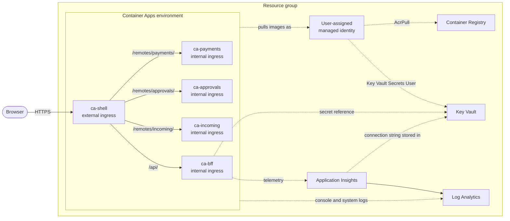
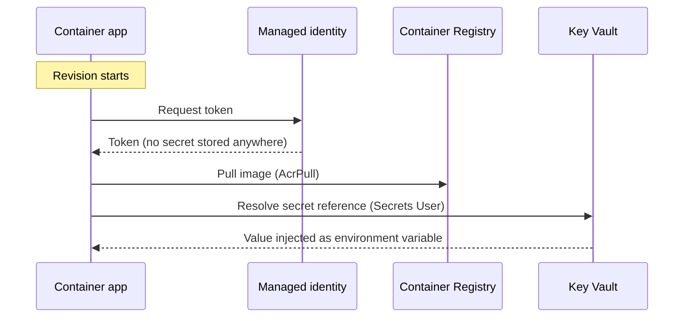

# Azure infrastructure

This page explains the Bicep in [`infra/`](../../infra): what it creates, why it is shaped this way, and how you would deploy it. The templates compile cleanly but this repository **never deploys them**. Treat everything here as a reference you can read, run `az bicep build` against, and adapt.

## Architecture



Five container apps share one environment. Only the **shell** is reachable from the internet. It is an nginx container that serves the host application and reverse-proxies `/api/` to the BFF and `/remotes/<name>/` to each micro frontend. Everything else is internal.

## Why Container Apps

The workload is five small, stateless HTTP containers. That is the sweet spot for Azure Container Apps.

| Option | Why it was not chosen here |
| --- | --- |
| App Service for Containers | One plan per app or a shared plan. No scale to zero, no built-in internal-only service discovery between apps. |
| AKS | Powerful, but you own cluster upgrades, node pools, ingress controllers and policy. Too much machinery for five containers. |
| Container Instances | No ingress, scaling or revisions. Good for jobs, not for services. |
| **Container Apps** | Managed Kubernetes and Envoy underneath, HTTP scaling (including to zero), revisions, internal DNS between apps, managed identity and Key Vault references, no cluster to run. |

The decision is recorded in [ADR 0008](../adr/0008-azure-container-apps.md).

## Hand-written modules, and when to use Azure Verified Modules

Each module in [`infra/modules/`](../../infra/modules) is written by hand and kept small. That is deliberate: this repository is for learning, and a 40-line module that sets `adminUserEnabled: false` teaches more than a call into a module with 200 parameters.

For production, prefer **Azure Verified Modules (AVM)** from the public Bicep registry (`br/public:avm/res/...`). They are maintained by Microsoft, tested, versioned, and encode current best practice (diagnostic settings, locks, role assignments, private endpoints) that hand-written modules tend to miss or let drift. The trade-off is that you must read a module's interface before you trust it. See [ADR 0009](../adr/0009-bicep-for-infrastructure-as-code.md).

## Module tour

All of it is composed by [`infra/main.bicep`](../../infra/main.bicep), which targets a resource group.

### Naming and tags

```bicep
var uniqueSuffix = take(uniqueString(resourceGroup().id, workloadName, environmentName), 6)
var baseName = '${workloadName}-${environmentName}-${uniqueSuffix}'
```

Names follow `abbreviation-workload-environment-uniqueString`, for example `kv-november-dev-x7k2qa`. The abbreviations come from the Cloud Adoption Framework (`id`, `cr`, `log`, `appi`, `kv`, `cae`, `ca`). The suffix is only six characters because Key Vault names are limited to 24 characters, so `workloadName` is capped at eight.

Two exceptions are worth noticing. Container Registry names allow no hyphens, so it is `cr${workloadName}${environmentName}${uniqueSuffix}`. Container app names only need to be unique inside their environment, so they are short and predictable (`ca-bff-dev`). That predictability is what lets the shell proxy to `http://ca-bff-dev`.

Every resource gets the same tags (`workload`, `environment`, `managed-by`) merged with the `tags` parameter.

### `identity.bicep`

A single user-assigned managed identity. It outlives any individual container app, so role assignments can be made once, before an app exists. That ordering matters: an app that references a Key Vault secret fails to provision if its identity cannot read the secret yet.

All five apps share it for simplicity. A production system would usually use one identity per app so that, for example, the nginx apps cannot read the BFF's secrets.

### `containerRegistry.bicep`

```bicep
properties: {
  adminUserEnabled: false
  publicNetworkAccess: 'Enabled'
}
```

The admin user is the registry's shared username and password, so it stays off. The same file assigns **AcrPull** to the identity, scoped to the registry only:

```bicep
resource acrPull 'Microsoft.Authorization/roleAssignments@2022-04-01' = {
  name: guid(registry.id, pullerPrincipalId, acrPullRoleDefinitionId)
  scope: registry
```

The role assignment name is a `guid()` of scope, principal and role, so re-deploying is idempotent.

### `monitoring.bicep`

A Log Analytics workspace and a **workspace-based** Application Insights component (`IngestionMode: 'LogAnalytics'`), so traces, requests and container logs all land in one queryable store. The `dailyQuotaGb` parameter caps ingestion. Dev sets it to 1 GB so a noisy bug cannot produce a surprise bill.

### `keyVault.bicep`

```bicep
enableRbacAuthorization: true
enableSoftDelete: true
softDeleteRetentionInDays: softDeleteRetentionInDays
enablePurgeProtection: enablePurgeProtection ? true : null
```

* **RBAC authorization** replaces access policies. Access is an ordinary role assignment, visible in the same place as every other one.
* **Purge protection** is a parameter because it is irreversible: once on, the vault name stays reserved for the retention period even after deletion. Dev leaves it off so you can tear down and re-create freely. Azure rejects `enablePurgeProtection: false`, which is why the template passes `null` instead of `false`.
* The Application Insights connection string is stored as a secret, and the identity gets **Key Vault Secrets User** (read secrets, nothing else).

The connection string is not very sensitive (it only permits sending telemetry), but it is a good vehicle for the pattern. Real secrets, such as database passwords, would follow the same path.

### `containerAppsEnvironment.bicep`

A Consumption-only environment (`workloadProfileType: 'Consumption'`), so you pay per use and manage no nodes. Console and system logs go to the Log Analytics workspace. Peer-to-peer traffic encryption is on, which means traffic between apps in the environment is wrapped in mutual TLS by the platform.

### `containerApp.bicep`

The reusable module, called five times from `main.bicep`. Its interesting parts:

```bicep
ingress: {
  external: externalIngress
  targetPort: targetPort
  transport: 'auto'
  allowInsecure: !externalIngress
```

* `externalIngress` is the only thing that makes the shell public.
* `allowInsecure` is true for internal apps. The shell's nginx proxies to `http://ca-bff-dev`, plain HTTP, and Container Apps would otherwise answer with a redirect to HTTPS, which an nginx `proxy_pass` does not follow. The traffic never leaves the environment and is encrypted by peer traffic encryption. The external shell keeps `allowInsecure: false` so browsers are redirected to HTTPS.

Images and secrets use the managed identity, never a password:

```bicep
registries: [
  {
    server: registryServer
    identity: identityId
  }
]
secrets: [
  for secret in keyVaultSecrets: {
    name: secret.name
    keyVaultUrl: secret.keyVaultUrl
    identity: identityId
  }
]
```

Each app also gets a liveness and a readiness probe, resource limits, and an HTTP scale rule (`concurrentRequests`, default 50 per replica). The probe paths are parameters: `/health/live` and `/health/ready` for the BFF, `/healthz` for the nginx apps.

### `main.bicep`: wiring the apps

The BFF is the only app with application settings and a secret:

```bicep
env: [
  {
    name: 'Auth__Mode'
    value: 'Mock'
  }
  {
    name: 'APPLICATIONINSIGHTS_CONNECTION_STRING'
    secretRef: appInsightsSecretName
  }
]
```

The shell receives the four upstream URLs. They are built from the other modules' outputs, not from literal strings:

```bicep
value: 'http://${bff.?outputs.name ?? appNames.bff}'
```

That reference makes Bicep deploy the shell after its upstreams. It matters because nginx resolves upstream host names when it starts, and a name that does not exist yet would stop the container from starting.

### The `deployApps` switch

Container apps cannot be created until their images exist, and images cannot be pushed until the registry exists. `deployApps` breaks the circle:

1. Deploy with `deployApps=false`. This creates identity, registry, monitoring, Key Vault and the environment.
2. Push the five images to the new registry.
3. Deploy again with `deployApps=true` and the real `imageTag`.

Bicep deployments are incremental, so the second run only adds the apps. The Azure Pipelines definition in [`pipelines/deploy.yml`](../../pipelines/deploy.yml) follows exactly this order.

## Identity and secrets

There are no passwords, keys or connection strings in the templates, the parameter files or the pipeline definitions.



* **Pulling images**: the platform presents the identity's token to the registry. The identity holds only AcrPull.
* **Secrets**: the BFF's `APPLICATIONINSIGHTS_CONNECTION_STRING` is a Key Vault reference. The app's own configuration holds a URL, not a value. Rotating the secret in Key Vault needs no template change. The URL has no version suffix, so it always follows the latest version, and a new or restarted revision picks the new value up.
* **Deployments**: the pipeline authenticates with an OIDC federated credential, so no client secret exists to leak. See [CI/CD](ci-cd.md).

The BFF's persona login (`Auth__Mode=Mock`) is a demo feature, not a security control. It is on in every environment because this system has no real users.

## Networking and ingress

Only the shell has an external ingress. That is a design decision, not an accident:

* One public surface to protect, monitor and put a WAF in front of.
* The browser talks to a single origin, so there is no CORS and the session cookie is first-party.
* The BFF and remotes cannot be called directly from the internet, so their authentication logic is never the only line of defence.

Internal apps are reachable by their short name inside the environment, for example `http://ca-bff-dev`. Container Apps routes by the HTTP `Host` header at its Envoy ingress. The shell's nginx therefore keeps the upstream's `Host` header when it proxies. If it forwarded the browser's host instead, Envoy would not know which app the request was for and would reject it.

The default environment has a public IP but internal apps never listen on it. For a private network, see the hardening checklist.

## Environments and parameter files

The same template serves every environment. Differences live in two parameter files:

| Parameter | [`main.dev.bicepparam`](../../infra/main.dev.bicepparam) | [`main.prod.bicepparam`](../../infra/main.prod.bicepparam) | Why |
| --- | --- | --- | --- |
| `acrSku` | `Basic` | `Premium` | Premium adds geo-replication, zone redundancy and private endpoints. |
| `enableKeyVaultPurgeProtection` | `false` | `true` | Dev must be disposable. Prod must not lose a secret to a mistaken delete. |
| `keyVaultSoftDeleteRetentionInDays` | 7 | 90 | Recovery window. |
| `logRetentionInDays` | 30 | 90 | Investigation window. |
| `logDailyQuotaGb` | 1 | -1 (no cap) | Cap cost in dev, never drop data in prod. |
| `shellScale` | 0 to 2 | 2 to 10 | Dev scales to zero. Prod keeps two replicas for availability. |
| `bffScale` | 0 to 2 | 2 to 10 | As above. |
| `remotesScale` | 0 to 2 | 1 to 5 | Static assets are cheap to serve. |

Scale to zero means the first request after an idle period waits a few seconds while a replica starts. That is acceptable in dev and not in prod.

`imageTag` defaults to `latest` in both files and is overridden at deploy time with the commit SHA. A mutable tag like `latest` is only a fallback, never something to deploy from.

## How you would deploy

Nothing here has been run against a real subscription. If you had one, the manual path looks like this. Replace the placeholders.

```bash
az login
az account set --subscription <subscription-id>
az group create --name rg-november-dev --location westeurope
```

Step 1, foundation only. Always preview first with `what-if`:

```bash
az deployment group what-if \
  --resource-group rg-november-dev \
  --template-file infra/main.bicep \
  --parameters infra/main.dev.bicepparam deployApps=false

az deployment group create \
  --resource-group rg-november-dev \
  --template-file infra/main.bicep \
  --parameters infra/main.dev.bicepparam deployApps=false \
  --query properties.outputs.acrName.value --output tsv
```

Step 2, build and push the images. `az acr build` runs the build inside Azure, so you need no local Docker:

```bash
TAG=$(git rev-parse --short HEAD)
ACR=<acr-name-from-step-1>
az acr build --registry $ACR --image november-bff:$TAG ./bff
for app in shell payments approvals incoming; do
  az acr build --registry $ACR --image november-$app:$TAG \
    --build-arg APP=$app --file frontend/Dockerfile ./frontend
done
```

Step 3, the apps:

```bash
az deployment group create \
  --resource-group rg-november-dev \
  --template-file infra/main.bicep \
  --parameters infra/main.dev.bicepparam imageTag=$TAG deployApps=true \
  --query properties.outputs.shellUrl.value --output tsv
```

The command prints the shell's public URL. When a `.bicepparam` file is used, `--parameters` can be given only once, so inline overrides go on the same argument, after the file.

The deploying identity needs permission to create role assignments (Owner, User Access Administrator, or Role Based Access Control Administrator on the resource group), because the templates assign AcrPull and Key Vault Secrets User.

To compile without an Azure subscription, which is what CI does:

```bash
az bicep build --file infra/main.bicep --stdout > /dev/null
az bicep build-params --file infra/main.dev.bicepparam --stdout > /dev/null
az bicep build-params --file infra/main.prod.bicepparam --stdout > /dev/null
```

## Rough cost notes

These are ballpark figures to build intuition. Prices change by region and over time. Use the Azure pricing calculator for numbers you will rely on.

| Item | Dev | Prod |
| --- | --- | --- |
| Container Apps | Scaled to zero when idle. A monthly free grant of vCPU-seconds, memory and requests usually covers light demo use. | Replicas that stay up are billed per second for CPU and memory (a lower "idle" rate applies while they receive no requests). Expect tens to low hundreds of dollars a month for the minimum replicas, more with traffic. |
| Container Registry | Basic tier, a few dollars a month. | Premium tier, roughly tens of dollars a month. |
| Log Analytics and Application Insights | Per-GB ingestion with a 1 GB daily cap. | Per-GB ingestion, uncapped. Usually the largest cost surprise, so watch it. |
| Key Vault | Cents. Charged per operation. | Cents. |
| Managed identity | Free. | Free. |

The biggest dev saving is scale to zero. The biggest prod lever is `minReplicas` on the shell and BFF.

## Production hardening checklist

What a production deployment would add beyond this reference.

- [ ] **Private networking**: deploy the environment into a virtual network (VNet integration), with the shell fronted by a private path. Add private endpoints for Container Registry and Key Vault, then set their `publicNetworkAccess` to `Disabled`.
- [ ] **Edge protection**: put Azure Front Door with a WAF policy in front of the shell, and make the shell's ingress accept only Front Door traffic.
- [ ] **Azure Verified Modules**: replace hand-written modules with AVM versions, pinned to a version.
- [ ] **One identity per app**, each with only the roles it needs.
- [ ] **Entra authentication for telemetry**: disable local auth on Application Insights and Log Analytics where the SDKs support it.
- [ ] **Real authentication**: replace persona login (`Auth__Mode=Mock`) with Entra ID or another OpenID Connect provider.
- [ ] **Image supply chain**: scan images (Defender for Containers or a scanner in CI), sign them, pin base images by digest, and deploy by digest rather than tag.
- [ ] **Microsoft Defender for Cloud**: enable plans for Containers, Key Vault and Resource Manager.
- [ ] **Resilience**: zone-redundant environment and registry, and a second region behind Front Door with a documented failover.
- [ ] **Governance**: resource locks on the vault and registry, Azure Policy for allowed regions, SKUs and tags, diagnostic settings on every resource.
- [ ] **Alerts**: availability tests on the shell, alerts on 5xx rate, restarts and replica count, routed to an action group.
- [ ] **Separate subscriptions** for dev and prod, with state and approvals to match.
