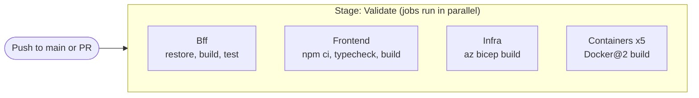
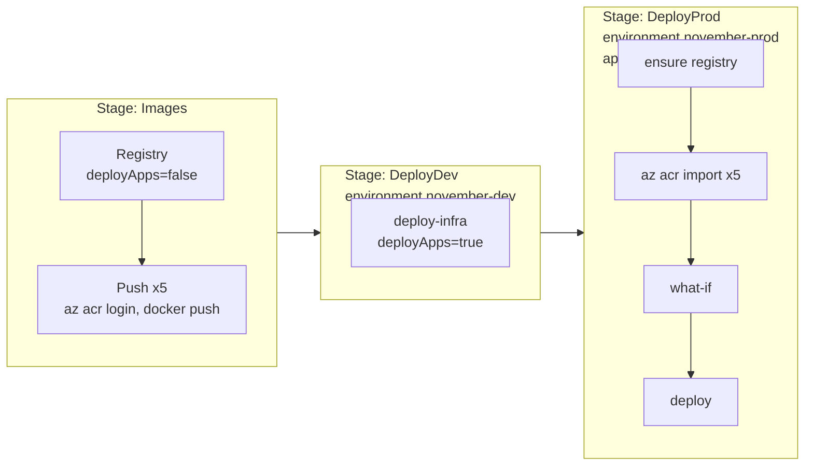

# CI/CD

The primary CI/CD reference for this repository is **Azure Pipelines**, because that is where the real-world system this project teaches from lives. The YAML is in [`pipelines/`](../../pipelines). A small GitHub Actions workflow also exists, only so this public mirror shows a green build. See [ADR 0010](../adr/0010-azure-pipelines-for-ci-cd.md).

> The pipelines are **unexecuted references**. No Azure DevOps organization or Azure subscription was used while writing them. They were checked for YAML syntax only. Expect to adjust names, pool images and service connections the first time you run them.

## Layout

```text
pipelines/
  ci.yml                   PR validation and main builds
  deploy.yml               build and push images, deploy dev, then prod
  templates/
    dotnet-build.yml       restore, build, test, publish results
    frontend-build.yml     Node, npm cache, ci, typecheck, build
    bicep-validate.yml     az bicep build for main and each param file
    docker-build.yml       Docker@2 build only (CI)
    push-images.yml        az acr login, docker build, docker push
    promote-images.yml     az acr import from one registry to another
    deploy-infra.yml       resource group, what-if, deployment, outputs
  variables/
    common.yml             tool versions and shared names
    dev.yml                service connection, resource group, param file
    prod.yml               same keys, prod values
.azuredevops/
  pull_request_template.md
```

## CI pipeline: `pipelines/ci.yml`



Four jobs run in parallel on a Microsoft-hosted `ubuntu-latest` agent. Each job is a few lines because the real work lives in a template:

```yaml
- job: Bff
  steps:
    - template: templates/dotnet-build.yml
      parameters:
        workingDirectory: $(bffDirectory)
        solution: $(bffSolution)
        dotnetVersion: $(dotnetVersion)
        buildConfiguration: $(buildConfiguration)
```

* **Bff** installs the .NET 10 SDK (`UseDotNet@2`), runs restore and build with `DotNetCoreCLI@2`, runs the tests with `dotnet test --solution` from the `bff` folder (where `global.json` switches the SDK to the Microsoft.Testing.Platform runner), and publishes the `.trx` results with `PublishTestResults@2` so failures show in the run's **Tests** tab.
* **Frontend** installs Node 24 (`NodeTool@0`), restores the npm cache with `Cache@2`, then runs `npm ci`, `npm run typecheck`, `npm run build`. The cache key includes the lockfile, so it is rebuilt only when dependencies change:

  ```yaml
  key: 'npm | "$(Agent.OS)" | ${{ parameters.workingDirectory }}/package-lock.json'
  ```

* **Infra** runs `az bicep build` on `main.bicep` and `az bicep build-params` on both parameter files. This needs no Azure login: it only compiles and lints.
* **Containers** is a `matrix` of five entries (one per image). Each runs `Docker@2` with `command: build` and **no push**. It proves every Dockerfile builds.

### Triggers

```yaml
trigger:
  branches:
    include:
      - main
  paths:
    include:
      - bff
      - frontend
      - infra
      - pipelines
      - docker-compose.yml
```

Documentation-only changes do not start a build. For **Azure Repos Git**, the `pr:` block in the file is not what runs pull request validation. YAML `pr:` triggers apply to GitHub and Bitbucket repositories. In Azure Repos, a **branch policy** with build validation is the trigger (see below). The block is kept so the file behaves the same if the repository is mirrored.

The pipeline must be created with the name **`november-ci`**, because `deploy.yml` refers to it by that name.

## Deploy pipeline: `pipelines/deploy.yml`

It runs manually, or automatically after `november-ci` succeeds on `main` (the `resources.pipelines` trigger). It has no secrets: every Azure call goes through a service connection.



1. **Images.** The `Registry` job deploys the Bicep with `deployApps=false`, which creates the registry and supporting services. The `Push` job (a five-way matrix) logs in to that registry and builds and pushes each image tagged `$(Build.SourceVersion)`, the commit SHA. The reason for the two-phase deployment is explained in [the infrastructure guide](README.md#the-deployapps-switch).
2. **DeployDev.** A `deployment` job against the `november-dev` environment runs the full deployment with `deployApps=true` and the image tag.
3. **DeployProd.** The `november-prod` environment has approvals and checks, so the stage waits for a person. Once approved it creates the prod registry, **promotes the same images** from the dev registry with `az acr import`, shows a `what-if`, and deploys. Importing instead of rebuilding means prod runs the exact bytes that were tested in dev.

The deployment step uses a bicepparam file with an inline override:

```yaml
az deployment group create \
  --name november-$(Build.BuildId)-${{ lower(parameters.deployApps) }} \
  --resource-group ${{ parameters.resourceGroup }} \
  --template-file infra/main.bicep \
  --parameters ${{ parameters.parameterFile }} imageTag=${{ parameters.imageTag }} deployApps=${{ lower(parameters.deployApps) }}
```

The step publishes `acrName`, `acrLoginServer` and `shellUrl` as **output variables**, which later jobs and stages read, for example `$[ dependencies.Registry.outputs['registry.acrName'] ]`.

### Templates

Templates remove duplication and give each concern one home. `deploy-infra.yml` is used four times with different parameters:

```yaml
- template: templates/deploy-infra.yml
  parameters:
    serviceConnection: $(serviceConnection)
    resourceGroup: $(resourceGroup)
    location: $(location)
    parameterFile: $(parameterFile)
    imageTag: $(imageTag)
    deployApps: false
    stepName: registry
```

Template **parameters** are typed (`string`, `boolean`, `object`) and are expanded when the pipeline is compiled, so `${{ if eq(parameters.runWhatIf, true) }}` can add or remove whole steps. **Variables** referenced as `$(name)` are expanded at run time.

### Variables

Non-secret values live in [`pipelines/variables/`](../../pipelines/variables). A stage includes one file, so the stage body reads the same for both environments:

```yaml
- stage: DeployProd
  variables:
    - template: variables/prod.yml
```

`dev.yml` and `prod.yml` define the same keys (`serviceConnection`, `resourceGroup`, `parameterFile`, `environmentName`) with different values.

**Secrets** do not belong in these files. This repository needs none, but if you add one, create a **variable group** (Pipelines, Library) and use **Link secrets from an Azure key vault**. Pipelines then fetches the values at run time using a service connection, and they never appear in the YAML or the repository. Reference the group with `- group: november-secrets` in `variables:`.

## One-time Azure DevOps setup

### 1. Create the pipelines

Pipelines, New pipeline, Azure Repos Git, **Existing Azure Pipelines YAML file**:

| Name | File |
| --- | --- |
| `november-ci` | `/pipelines/ci.yml` |
| `november-deploy` | `/pipelines/deploy.yml` |

### 2. Create service connections with workload identity federation

Workload identity federation lets Azure DevOps authenticate to Azure with a short-lived token it issues itself. There is no client secret to store, rotate or leak.

1. Project settings, **Service connections**, New service connection, **Azure Resource Manager**.
2. Choose **Workload identity federation (automatic)**. Azure DevOps creates an app registration in Microsoft Entra ID and a federated credential for you. Use **manual** if you must bring your own app registration or managed identity.
3. Scope the connection to the subscription and, if allowed, to a single resource group. Name it exactly `sc-november-dev` (and `sc-november-prod` for the second one). Those names are in `variables/dev.yml` and `variables/prod.yml`.
4. Untick **Grant access permission to all pipelines**. Authorise `november-deploy` explicitly.
5. Assign roles to the connection's service principal, at the resource group of each environment:

| Role | Why |
| --- | --- |
| Contributor | Create the resources in the Bicep. |
| Role Based Access Control Administrator (or User Access Administrator) | The Bicep creates role assignments (AcrPull, Key Vault Secrets User). |
| AcrPush | `docker push` to the registry that the Bicep created. |

For prod, also give the prod service principal **AcrPull** on the dev registry (or its resource group) so `az acr import` can read the images.

If you create the credential manually, the federated credential values look like this:

| Field | Value |
| --- | --- |
| Issuer | `https://vstoken.dev.azure.com/<organization-id>` |
| Subject | `sc://<organization>/<project>/sc-november-dev` |
| Audience | `api://AzureADTokenExchange` |

### 3. Create environments, approvals and checks

Pipelines, **Environments**, create `november-dev` and `november-prod`. The `deployment` jobs name them:

```yaml
- deployment: Infra
  environment: november-prod
```

On `november-prod`, open **Approvals and checks** and add:

* **Approvals** from the people or group allowed to release.
* **Branch control** allowing only `refs/heads/main`.
* Optionally **Business hours** and **Exclusive lock** (one deployment at a time).

Checks are evaluated before the job starts, and a deployment job also records every deployment in the environment's history, so you can see what version is where.

### 4. Branch policies

Repos, Branches, `main`, **Branch policies**:

| Policy | Setting |
| --- | --- |
| Require a minimum number of reviewers | 1 or more. Tick **Prohibit the most recent pusher from approving**. |
| Check for linked work items | Required. |
| Check for comment resolution | Required. |
| Build validation | Pipeline `november-ci`, trigger **Automatic**, policy requirement **Required**, with path filter `/bff;/frontend;/infra;/pipelines;/docker-compose.yml`. |
| Limit merge types | Squash merge. |

The build validation policy is what runs `ci.yml` on every pull request. The pull request description is pre-filled from [`.azuredevops/pull_request_template.md`](../../.azuredevops/pull_request_template.md).

## GitHub Actions and Azure Pipelines compared

| GitHub Actions | Azure Pipelines | Notes |
| --- | --- | --- |
| Workflow (`.github/workflows/*.yml`) | Pipeline (any YAML file you register) | Pipelines are registered by hand in the UI. |
| `on: push` / `pull_request` | `trigger:` / `pr:` plus branch policy | In Azure Repos, PR runs come from a build validation policy. |
| Job (`jobs:`) | Job (`jobs:`), grouped into **stages** | Pipelines has an explicit stage level for gates. |
| `runs-on: ubuntu-latest` | `pool: vmImage: ubuntu-latest` | |
| Step `uses: action@v4` | Step `task: Task@2` | Tasks come from the Marketplace or are built in. |
| Step `run:` | Step `script:` or `bash:` | |
| Reusable workflow or composite action | Template (`- template:`) | Templates take typed parameters and expand at compile time. |
| `strategy.matrix` | `strategy.matrix` | Same idea, different syntax. |
| `concurrency` | Exclusive lock check, run queueing | |
| `actions/cache` | `Cache@2` | |
| Environment with required reviewers | Environment with approvals and checks | Pipelines checks are more varied (branch control, REST, exclusive lock). |
| Repository and environment secrets | Variable groups, optionally linked to Key Vault | |
| OIDC (`azure/login` with `id-token: write`) | Service connection using workload identity federation | Same federated-credential mechanism underneath. |
| `GITHUB_SHA` | `Build.SourceVersion` | |
| Job `outputs` | Output variables (`isOutput=true`) | |
| `workflow_dispatch` | Manual run, with runtime `parameters:` | |
| Dependabot | Renovate, or GitHub Advanced Security for Azure DevOps | Azure DevOps has no built-in version update PRs. |

## Dependency updates

[`.github/dependabot.yml`](../../.github/dependabot.yml) covers NuGet (`/bff`), npm (`/frontend`), GitHub Actions (`/`) and Docker (`/bff`, `/frontend`). Each runs weekly and groups updates so one pull request carries a related batch.

Azure Repos has no equivalent built in. Options are the Renovate bot, run as a pipeline on a schedule, or dependency scanning from GitHub Advanced Security for Azure DevOps, which raises alerts rather than pull requests.

## The GitHub workflow

[`.github/workflows/ci.yml`](../../.github/workflows/ci.yml) exists so the public GitHub copy of this repository shows a real, green build. It is not the deployment path. It runs the same four checks as `pipelines/ci.yml` (BFF, frontend, infra and the five-image container matrix), with `permissions: contents: read`, a concurrency group that cancels superseded runs, and the GitHub Actions cache for Docker layers. There is no GitHub deploy workflow: deployment is defined only in Azure Pipelines.

One caveat applies to path filters. If you make a GitHub check *required* and the workflow is skipped by a path filter, the check stays pending and blocks the merge. Either leave it non-required, or remove the `paths` filters.
