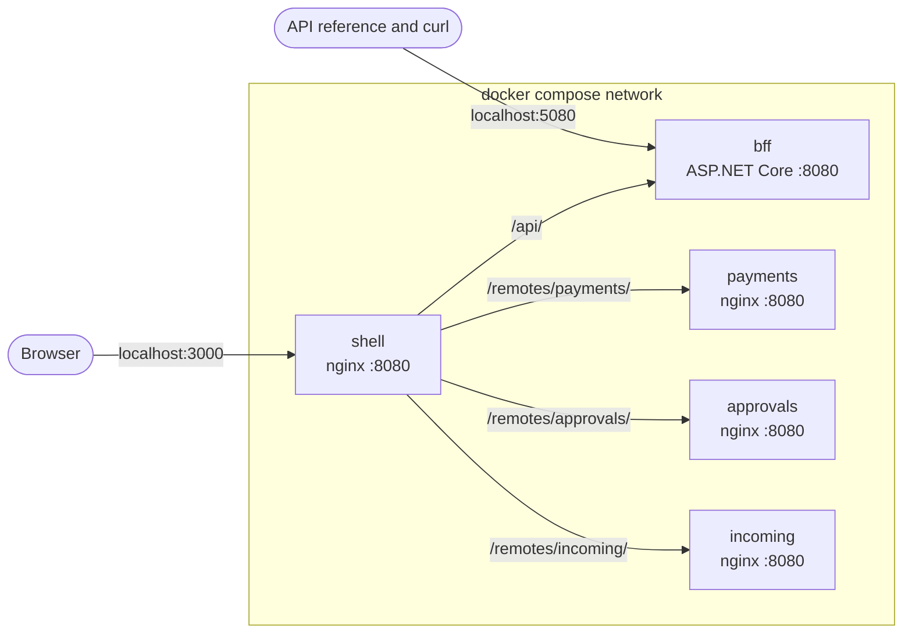

# Container strategy

November ships as five container images. This page covers how they fit together locally with Docker Compose, and the conventions every image follows so that the same images run unchanged on Azure Container Apps.

## Topology



The shell is the single entry point. Open **http://localhost:3000** and you are on the shell's origin: the page, the micro frontend bundles and the API all come from there. The browser never talks to the BFF or a remote directly, which is why there is no CORS configuration anywhere.

The definition is [`docker-compose.yml`](../../docker-compose.yml) at the repository root.

## Ports

| Service | Inside the container | Published on the host | Notes |
| --- | --- | --- | --- |
| shell | 8080 | **3000** | The only app you normally open. |
| bff | 8080 | 5080 | Published so you can reach the API reference at http://localhost:5080/scalar. Same port as `dotnet run` uses locally. |
| payments, approvals, incoming | 8080 | none | Reachable only through the shell. |

Every container listens on 8080. Non-root processes cannot bind ports below 1024, so 8080 is a requirement, not a preference. It is also what Azure Container Apps is told to target in [`containerApp.bicep`](../../infra/modules/containerApp.bicep).

## The single-entry-point proxy

The shell's nginx reads four environment variables and uses them as proxy targets:

```yaml
shell:
  environment:
    BFF_UPSTREAM: http://bff:8080
    PAYMENTS_UPSTREAM: http://payments:8080
    APPROVALS_UPSTREAM: http://approvals:8080
    INCOMING_UPSTREAM: http://incoming:8080
```

In Compose these are service names, which Docker's built-in DNS resolves. In Azure the same variables hold `http://ca-bff-dev` and friends, set by [`main.bicep`](../../infra/main.bicep). The image is identical in both places, so **the environment variables are the only thing that differs** between local and cloud. The shell reads them when the container starts, so changing a target never needs a rebuild.

`depends_on` makes Compose start the four upstreams before the shell, which keeps the first page load tidy. It is not required for correctness: the shell resolves each upstream name when a request arrives, not when nginx starts, so a missing upstream only fails requests to that path (with a `502`) and the rest of the portal keeps working.

## Image conventions

### Non-root

No image runs as root. The frontend images use the unprivileged nginx variant, and the BFF uses a chiseled (distroless-style) .NET runtime image that runs as a non-root user by default. If someone breaks into the process, they hold fewer privileges and cannot install tools or modify the image's files.

### Multi-stage builds

Each Dockerfile builds in one stage and copies only the output into a small runtime stage:

* **BFF** ([`bff/Dockerfile`](../../bff/Dockerfile)): .NET SDK image to restore, build and publish, then the chiseled ASP.NET runtime image.
* **Frontend** ([`frontend/Dockerfile`](../../frontend/Dockerfile)): Node image to run `npm ci` and build the chosen app, then nginx to serve the static output.

The compilers, source code and `node_modules` never reach the final image. Images are smaller, start faster and carry far less to patch.

### One Dockerfile for four apps

`frontend/Dockerfile` takes a build argument, `APP`, naming which workspace to build:

```yaml
payments:
  build:
    context: ./frontend
    dockerfile: Dockerfile
    args:
      APP: payments
```

The context is `./frontend` (the workspace root), not the app's own folder, because the apps share packages and one lockfile. One parameterised Dockerfile avoids four copies drifting apart.

### Health checks

Each frontend container answers `GET /healthz` with 200, and its image declares a `HEALTHCHECK` that calls it, so `docker compose ps` shows `healthy` for the four front end services. The BFF exposes `/health/live` (is the process up) and `/health/ready` (can it serve traffic). The BFF image is chiseled and has no shell, so it cannot run a `HEALTHCHECK` command, and Compose does not define one. In Azure the platform probes the same paths over HTTP, configured in `containerApp.bicep`, so no shell is needed there either.

### Tagging

| Where | Tag | Reason |
| --- | --- | --- |
| Local Compose | `november-<name>` (implicitly `latest`) | Convenience. |
| CI builds | `november-<name>:ci` (GitHub) or `$(Build.BuildId)` (Azure Pipelines) | Built to prove it compiles, never pushed. |
| Deployments | `november-<name>:<commit SHA>` | Immutable and traceable to the exact source. |

Never deploy `latest`. It means something different every time you look.

## Running locally

You need Docker with Compose v2. Nothing else.

```bash
docker compose up --build
```

Then open **http://localhost:3000**. Sign in as one of the demo personas (Alex Morgan, Sam Okafor or Jordan Reeves).

Useful variations:

```bash
docker compose up --build -d
docker compose logs -f shell bff
docker compose ps
docker compose down
```

To rebuild one image after a code change: `docker compose build payments`, then `docker compose up -d payments`.

The BFF runs with `ASPNETCORE_ENVIRONMENT=Development` in Compose so the interactive API reference is available at http://localhost:5080/scalar. The Azure deployment leaves it at Production.

## Troubleshooting

| Symptom | Likely cause and fix |
| --- | --- |
| `port is already allocated` on 3000 or 5080 | Another process holds the port. Stop it, or change the left side of the mapping in `docker-compose.yml` (for example `"3001:8080"`). |
| Shell loads but `/api/...` returns 502 or 504 | The BFF is still starting or crashed. Run `docker compose logs bff`. The BFF takes a few seconds to become ready. |
| A micro frontend area is blank or 404 | The matching container is down or built from the wrong app. Check `docker compose ps` and rebuild with `docker compose build <name>`. |
| `502 Bad Gateway` for one path only (`/api/` or `/remotes/<name>/`) | That upstream container is not running, or is still starting. Check `docker compose ps`, then `docker compose logs <name>`. The other paths keep working. |
| Build fails with `npm ci` lockfile errors | The lockfile and `package.json` disagree. Run `npm install` in `frontend/`, commit the lockfile, rebuild. |
| Changes are not showing up | You are running an old image. Use `docker compose up --build`, or `docker compose build --no-cache <name>` to bypass layer caching. |
| Scripts fail with `\r: command not found` | Windows line endings in a shell script. [`.gitattributes`](../../.gitattributes) forces LF, so re-checkout the file after pulling the repository's attributes. |
| Cookies or login behave strangely | Always use `http://localhost:3000`. The session cookie belongs to that origin, so mixing `localhost` and `127.0.0.1` gives you two separate sessions. |
